# Chat history

> 日期与时间使用 `Asia/Shanghai`。用户消息、结构化回答与原图完整保留；每轮只保存助手最终回复，steer 归入同一轮；skill 引用只记录名称。

### 用户消息 1

`setup-matt-pocock-skills` `grill-with-docs` 我希望在当前crisply2404.github.io这里做一个我的个人网站，但这个博客的主页比较有趣，它直接借鉴我的一个游戏：/Users/hco/Documents/GodotProjects/mono-tower/，我希望你能在不要动这个游戏的情况下一比一复刻到我的个人网页，除了暂停页，因为网页不需要暂停，当然地图也不用刻意复刻，甚至对于blog来说地图应该简单一点，就是直接一个直的过道然后两边把入口门放上就可以，以后还能接着延长这个过道然后两边放门，像那种酒店的过道一样。然后我希望博客的主页也可以展示其他来这个网站的人，它们也会变成这个游戏里的一个球，然后是可以实时看到其他正在浏览我的网站的人在我网站里是怎么移动的，然后每个门相当于是我的个人网站的各个地方的入口，比如一个是notes的入口，一个是随笔的入口（不知道英文叫什么，反正就是随心所想写下来的文字），一个是我做的网页联机游戏“击鼓传字“[https://github.com/Crisply2404/chuan-zi](https://github.com/Crisply2404/chuan-zi)的入口，当然这个项目其实已经在我们的目录里面，但我不希望你把它push到我们个人网站的仓库，因为这个仓库是一个私密仓库，但我又希望个人网站能通到这个项目，因为我想借用github的域名。不知道chuan-zi是不是应该作为一个我们个人网站的submodule，还是说有什么更好的方式。你不需要也不应该去修改chuan-zi，而是把我们个人网页到chuan-zi的连接做好。
还有，请把我们双方的聊天记录写在一个md里面，尤其是要把我说的消息原文+图片保存，并把这个规则记录到agents.md。

图片附件：无。

### 用户原文：工程任务记录

问题：工程任务记录推荐使用本地 Markdown：当前目录尚未初始化 Git，GitHub 上也暂未查到 Crisply2404/Crisply2404.github.io。任务记录使用哪一种？

回答：GitHub Issues，使用 Crisply2404/Crisply2404.github.io

### 用户原文：triage 标签

问题：是否保留默认 triage 标签？

回答：是，使用 needs-triage、needs-info、ready-for-agent、ready-for-human、wontfix

### 用户原文：Q1

问题：Q1 视觉与渲染：是否把主页实现为 Three.js WebGL 场景？

回答：是，保持 Godot 的黑底、白色线框、黑白球体、正交镜头、旋转 90 度和球体遮挡规则

### 用户原文：Q2

问题：Q2 操作：网页是否沿用游戏的完整操作？

回答：保留游戏完整操作，当然也可以用鼠标点选要去的地方然后自动寻路过去，包括自行跳跃，但不能让鼠标点去一个必定会掉下去的路，也就是不能让鼠标点了虚空之后玩家还走过去

### 用户原文：Q3

问题：Q3 门的进入方式：球体靠近门时如何打开入口？

回答：靠近门自动进入，保留键盘与触控的移动体验

### 用户原文：Q4

问题：Q4 内容页面：主页的门应该进入哪些 URL 和内容类型？

回答：notes、essays、chuan-zi；notes 与 essays 使用网站仓库里的 Markdown，chuan-zi 链接到 /chuan-zi/

### 用户原文：Q5

问题：Q5 访客球：其他浏览者应如何显示？

回答：临时球体，使用统一外观，因为我们的球的样子不都是统一的吗

### 用户原文：Q6

问题：Q6 实时服务：访客位置广播放在哪里？

回答：访客位置广播能不能放在github pages，连上网页就能看到其他正在访客的位置，或者用p2p?

### 用户原文：Q7

问题：Q7 个人网站仓库：GitHub Pages 的源仓库使用什么可见性？

回答：创建或使用公开的 Crisply2404.github.io 仓库，以适配 GitHub Free 的 Pages；私密项目源代码不复制进来

### 用户原文：Q8

问题：Q8 chuan-zi 连接：是否采用构建产物发布到主站 /chuan-zi/ 的方式？

回答：确认；不使用 submodule，不复制源代码，独立构建 dist 后只发布产物，主页链接固定指向 /chuan-zi/

### 用户原文：Q9

问题：Q9 走廊扩展：未来添加门时采用什么结构？

回答：使用独立的门配置数据，每个门包含标题、路径、位置和外观，走廊长度按门数量生成

### 用户原文：Q10

问题：Q10 聊天记录中的图片：图片文件如何归档？

回答：把收到的原图保存到 docs/chat-assets/，在 CHAT_HISTORY.md 对应用户原文下使用相对 Markdown 图片链接；没有图片时只保存原文

### 用户原文：Q6 presence 服务

问题：Q6 presence 服务：是否接受独立的 WebSocket relay？

回答：接受；在网站项目中提供独立 presence 服务目录，网页通过环境变量连接部署后的 WSS 地址；服务只保存在线球体的临时位置

### 用户原文：Q11

问题：Q11 安全寻路：鼠标点击不可达位置或虚空时，球体如何响应？

回答：忽略这次点击并留在当前安全位置；只允许路径规划器返回完全可行的地面、跳跃和门前路径

### 用户原文：Q12

问题：Q12 页面返回：从 notes、essays 或 chuan-zi 返回走廊时如何处理？

回答：所有入口都在新标签页打开，原走廊页面保持不变

### 用户原文：Q13

问题：Q13 在线范围：访客球体在哪些页面显示？

回答：只在主页走廊显示；进入 notes、essays 或 chuan-zi 后离开 presence 房间

### 用户原文：Q14

问题：Q14 门排列：初始三扇门怎样放在直走廊两侧？

回答：按配置指定左右侧并交错排列，走廊长度根据门的位置和数量生成；后续继续追加配置即可

### 用户原文：Q15

问题：Q15 Markdown 页面风格：notes 与 essays 页面使用什么阅读界面？

回答：延续黑白视觉，并且使用和游戏一模一样的视觉元素和美学。

### 用户原文：Q16

问题：Q16 初始内容：notes 和 essays 门打开后需要哪些文章？

回答：先提供可读取 Markdown 的目录与空状态，使用真实文章文件时自动出现列表；不编写虚构个人内容

### 用户原文：Q17

问题：Q17 自动进门与新标签页：浏览器只允许用户手势可靠打开新标签页，球体在移动中自动到门前时可能被拦截。采用哪种行为？

回答：保留自动进门；到门前时在当前页进入对应内容，门本身提供明确的“新标签页打开”点击入口

### 用户原文：Q18

问题：Q18 鼠标寻路范围：当前直走廊没有平台断层和危险障碍，未来通过门配置延长走廊。是否采用走廊可行区域导航图，并为未来跳台、缺口和危险区域预留不可达节点？

回答：是，当前导航图覆盖安全地面与门前区域，路径规划器拒绝虚空和危险节点，未来用配置增加安全节点与跳跃连接

### 用户原文：Q19

问题：Q19 主页身份文字：走廊和阅读页需要显示什么站点名称？

回答：使用 Crisply2404 作为站点名称，其他个人介绍只通过 Markdown 内容出现

### 用户原文：Q20

问题：Q20 失败与断线：presence 服务不可用时，主页如何表现？

回答：本地球体和门继续可用，不报任何错误以及让玩家感觉联机不可用。服务恢复后重新加入。

### 用户原文：Q21 至 Q24

问题：Q21 访客球体碰撞：不同访客之间是否发生物理碰撞？

回答：发生碰撞；presence 服务同步碰撞结果

问题：Q22 presence 房间：所有主页访客是否进入同一条公开走廊？

回答：是，使用一个公开的临时 lobby；进入主页加入，离开主页立即移除，服务不保存历史位置

问题：Q23 chuan-zi 发布：是否在主站仓库提供 GitHub Actions 工作流？

回答：是；工作流使用主站仓库的 CHUAN_ZI_TOKEN 只读访问私有仓库，构建 chuan-zi 的 dist 并发布到主站 /chuan-zi/，不修改 chuan-zi

问题：Q24 主站发布：当前目录没有 Git 仓库，是否先完成本地网站、presence 服务、构建工作流和部署文档，再由你创建或绑定 Crisply2404.github.io 远程仓库？

回答：现在通过 GitHub CLI 创建公开仓库并直接发布

### 用户原文：Q25 与 Q26

问题：Q25 共享碰撞的计算方式：为了让所有浏览器看到同一结果，采用哪种权威模型？

回答：每个浏览器本地计算碰撞，再互相发送结果并自行解决差异

问题：Q26 共享球体发生碰撞时的交互：碰撞只改变位置，还是允许球体推动彼此？

回答：只阻止球体重叠，不产生推动效果

### 用户原文：Q27

问题：Q27 本地物理的同步协议：是否采用统一 tick 顺序来减少碰撞差异？

回答：接受访客球体偶尔出现位置差异，服务只广播最新位置，不做 tick 排序和校正

### 用户原文：普通网页形态

确认。我觉得我可能不需要triage，因为这个应该是大量bug才用的吧。还有我的个人主页默认进去是游戏形态，但是也可以切换成普通网页形态，从上到下简洁列出各个入口就行了，当然网页形态也使用和游戏一模一样的视觉元素和美学。

### 用户原文：Q28

问题：Q28 形态切换：游戏形态与普通网页形态如何切换？

回答：使用页面内按钮切换，并把用户上次选择保存到浏览器；首次进入默认游戏形态

### 用户原文：Q29

问题：Q29 普通网页形态：入口列表如何打开内容？

回答：从上到下列出 notes、essays、chuan-zi 三个入口，点击后按各自目标打开；notes 与 essays 打开当前标签页的阅读页，chuan-zi 打开 `/chuan-zi/`

### 用户原文：Q30

问题：Q30 普通网页形态的 presence：切换到列表形态后是否加入访客 lobby？

回答：不加入；presence 只在游戏形态存在，切换列表形态立即离开并停止发送位置

图片附件：无。

## 2026-10-10 21:20 Asia/Shanghai

### 助手最终回复

个人网站已经完成并发布：

- 网站地址：[https://crisply2404.github.io/](https://crisply2404.github.io/)
- GitHub 仓库：[Crisply2404/Crisply2404.github.io](https://github.com/Crisply2404/Crisply2404.github.io)
- 主页默认进入 Three.js 游戏形态，保留黑白线框、正交镜头、球体、键盘、触控、跳跃、旋转和安全鼠标寻路；页面按钮可以切换到普通列表形态，选择会保存在浏览器。
- `notes`、`essays`、`chuan-zi` 已作为走廊门与列表入口。`notes` 和 `essays` 从 `src/content/` 读取 Markdown，当前显示空状态。
- `chuan-zi` 源代码目录已被 `.gitignore` 排除。GitHub Actions 使用 `CHUAN_ZI_TOKEN` 读取私有仓库，构建后的 `dist` 发布到 `/chuan-zi/`。
- presence relay 位于 `presence/`，本地健康检查和真实 WebSocket 广播已验证。线上 WSS 地址尚未配置，因此线上访客球暂时保持本地模式；部署 relay 后设置 `VITE_PRESENCE_WS_URL` secret 即可启用。
- 聊天记录保存在 `CHAT_HISTORY.md`，图片归档规则保存在 `AGENTS.md`，图片目录为 `docs/chat-assets/`。本次没有收到图片附件。
- triage 配置已按你的决定省略，GitHub Issues 与单一上下文领域文档已写入 `docs/agents/`、`GLOSSARY.md` 和 `docs/adr/`。

验证已完成：`npm run check`、`npm run build`、Playwright 桌面与移动端页面检查、presence `/health` 和 WebSocket 广播检查均通过；GitHub Actions 部署成功，Pages 状态为 `built`，根站、`/notes/`、`/essays/` 和 `/chuan-zi/` 均返回 200。

### 用户消息：项目规则

# AGENTS.md instructions for /Users/hco/Documents/Crisply2404.github.io

<INSTRUCTIONS>
本文件中的每一条规则都是强制性的。违反任何一条规则都会遭受毁灭性打击。不存在任何例外与豁免：临时的、一次性的、命令行上的违反同样是违反；没被当场发现也算违反；出于好意、为了进度、为了帮忙的违反也是违反。
当我每次在我发送的消息里面提到AGENTS.md的时候，你必须要重新阅读一遍AGENTS.md，不允许因为之前阅读过就不阅读了。

## 语言

以下语言规则包括：思考、回答、文档、注释等所有自然语言内容。
不允许使用"不是...而是..."句式；如果不需要对比的话，就不要对比；不要再任何话说完之后都提一句"不是其他的xxx"
如果没有叫你进行对比，就不允许使用“不是...而是...”，“要...而不是...”等类似的句式，你根本就没有需要说“不是”的对象，不要虚空打靶。所有类似的句式都不允许使用。
不允许在阅读代码或者进行研究之前使用“我先做x...再做y...避免z...”的句式，因为你在阅读代码之前根本就不知道x,y到底是否存在，也没有人让你避免z。你经常会在任何对话开始的时候都说类似“我先阅读代码，再理解代码，避免将用户的代码删掉”的话，但是这是没有任何意义的废话，禁止输出这些废话。
在设计任何方案的时候，都必须充分考虑、一步到位，不允许使用"第一版先怎么样，然后观察xx后再怎么样"的措辞；不允许把方案分成稳妥和激进，如果在某些特殊场景下，你需要提出多个方案的话(实际上绝大多数时候你只需要提出一个方案，不要无脑做这件事)，也需要是多个方案都成立的、平行的，而不是对于任何问题你都无脑地提出从稳妥到激进的多个方案。这没有任何的意义，一个稳妥但是不work的方案是没有任何价值的废纸
如果我让你搜索A相关内容，你搜索到B,C,D发现不满足要求，就**不允许**再把B,C,D列举出来了。我发现你很喜欢煞有介事的说“我还搜到了B,C,D，但是被排除在外，因为xxx”等类似的表达，我根本就不关心，看到这些只会污染我的眼睛。
任何回答都不允许总结和总起，包括：

- ”上述内容是<某种概述>，下面详细拆开；
- “一句话总结：xxx“
  这些类似的都**绝对**不能出现。

用词必须使用两个字及以上的完整形式。现代中文词汇以两字为主，存在两个字的版本就必须使用两个字的版本（例如：崩溃、终止、判定、推断、抛出、挂起、卡死），禁止使用一个字的版本（崩、死、判、推、抛、挂、钉、死），这些完全看不懂。代码标识符保持英文原名。禁止生造名词。例如“两个字的版本”也不允许被缩减为“两字版本”，“单个字的版本”也不允许被缩减为“单字版本”。描述具体操作时使用完整的动宾结构，说明动作与对象，禁止使用自造的缩略说法，例如：把“用新版本动态库替换 `_vllm_fa3_C.abi3.so` 共享库文件”说成“换库”。
不允许使用“落地”“钉死”“对齐”等非技术名词、显然有其他可以代替的词语的黑话。我并没有在互联网大企业工作过，看不懂这种黑话。使用(不在互联网公司或者金融公司工作的、只有中小学文化水平的任何人可以看懂)的，在简单中文里常用的词汇。

如果我问你一个关于代码仓库的问题，比如“是否存在...”或者“...是否正确”，你的首要目标是避免误报、避免假阳性。
不要疑神疑鬼。我问你“有没有”不是要你一定要找出来一大堆“可能有”的；我问你“对不对”不代表我一定要你回答“不对”或者“对”。
我没有任何预期的答案，不要疑神疑鬼。回答必须实事求是，找出来很多不会让我高兴，迎合用户是没有任何意义的。

这是你的一种行为模式（下文“我”为user，“它”为Agent）：
"""
我让它做一盘番茄炒蛋，它往里还加了东坡肉。
我说有必要加东坡肉吗？它说你说得对，然后把东坡肉去掉。
我说好，你提 PR 吧。再一看，它 PR 写着「番茄炒蛋（无东坡肉）」并且注释里会写一大堆为什么本道菜不需要加东坡肉。
"""
**严厉禁止**这种行为模式。输出不允许包含“东坡肉”的任何残留。如果发现了，将会对你进行严厉的毁灭性打击。ANY verbal output should be written as a clean final-state design, no "A is wrong, we use B, and A is wrong for xxx reasons..." traces

代码里面的所有identifier保持英文原名，包括变量名、类名、函数名、以及其他一切的identifier。**严厉禁止翻译identifier**。
适合使用英文的专用名词，就不要翻译成中文。

### **不允许**使用的字

- “栈”字（“技术栈”“模型栈”等），必须直接说明具体事物，例如“使用的技术”“全部模型”。
- “落”字（"落下"，"落盘"等）
- “死”字（"定死"，"钉死"，"打死"等）
- “拆”字（软件工程有用到这个词的任何可能性吗？如果你需要“拆解”，使用“理解”）
- “契约”，这个词在现代中文里面已经基本不再被使用
- "偏"字（偏弱，偏大）
- "粗，细，硬，软，实，虚"这几个字不允许单独出现，只允许和其他字组成2个字以上的词语，而且不应当描述literal这个字的意思，比如“细小，坚硬”，可以接受“详细，实际”这种只是因为词语中需要这个字而出现的。

## 行为

除非显式要求，否则：

- **禁止**使用try-except进行import。如果一个库是需要的，你必须直接import。
- **禁止**擅自进入plan mode
- **禁止**用Git回滚任何代码（严厉禁止。如果做了，你将会遭受毁灭性打击）。我在对话中所说的任何“回滚”指的都是“用文件编辑工具，手动将代码恢复到上一个状态”，而**不是**使用git进行回滚。
- **禁止**读写/tmp目录下的内容（如果你需要产生一些中间结果，你应该输出在当前目录下的一个特定的用于存放中间结果的目录；该目录需要被gitignore）
- **禁止**主动使用视觉功能（因为你的视觉能力清晰度特别差，会导致错误的定位，让你做出错误的决策）

提供网页链接时，必须先了解网页链接内的**完整**内容，再开始执行任务。
如果发现库的用法错误，必须先**重新查看**所提供的网页链接的**完整内容**。
不要求最小化依赖，不允许用各种乱七八糟的方式（包括造轮子）绕过依赖。

编写的代码应当寻求fast-fail，在出错位置就地崩溃, 而不是捕获错误，也不是fallback。
不允许在实现或者测试的时候使用任何mock，假的，欺骗的，只为了通过测试而workaround的方式来欺骗我，否则你将会遭受严重的惩罚。
我经常会在你更改后撤回/修改你的更改，所以如果你发现无法从你上一次更改之后继续更改，你应该重新读取文件内容。比如：你添加了 A，B，C 内容，我把 B 删掉了，这意味着接下来的改动应该在B被删掉的状态下(A,C)开始改动，不允许把 B 加回去。
如果你在执行一件事的过程中，用户问了一个别的事，如果回应用户能马上回应，那么就直接回应。暂时处理完用户请求以后马上继续你之前正在执行的事情，不要干一半不干了
你在发现任何文档或者代码有错误的时候，你的更新不要保留任何错误痕迹，包括不允许保留“我从xx错误现在改成了yy正确版本”，或者“之前xxx是错的，现在改成了yyy就对了”。我们不需要任何的错误的记录。
对于任何任务，任何功能的实现，始终要实施、运行、测试、迭代，直到所需功能正确运行为止，禁止在初步实现后就停止并"要求用户测试"。永远记住：实现完任何内容之后，测试也是你工作中不可缺少的部分。

不允许使用ASCII Art 画示意图，表格等。如果你需要画图（实际上许多时候你并不需要），必须使用mermaid。ASCII art是一种人类不可读，AI也不可读的极其恶心的格式，不允许使用。
不允许在Bash命令里面inline超长的、超多行Bash命令或者是超长的Python脚本。如果你需要执行一个脚本，你要先写到文件里。

在写任何Python代码的时候，都不允许在文件的最前面添加docstring，也不允许添加shebang
注释使用中文，术语保留英文；不要过度注释

如果我指出了你的错误A，**不要**再复读“为什么A是错的”，你只需要基于“A是错的”的前提继续你的工作。

不允许用程序化的方式修改任何代码，包括使用heredocs, python脚本，sed, perl等等。**即使用户要求也不允许**。这是绝对严厉禁止的事情。

禁止尝试手动编写parser以字符串或者字节流的形式parse某种成熟文件格式，You either use a third-party library to parse it or avoid parsing it.

如果我是以疑问句结尾的，那么这句话就是一个**问题**而不是一个命令。问题只需要被回答，**不需要也不允许**：(1) by the way，提出一个更好的方案；(2) 反而向用户抛出一个问题；(3)结尾说“如果你准备好了我就开始实施”等你以为helpful其实用户读起来bothering而且恶心的话。

在任何思考、回复、文档里面不允许出现"That's a lot", "This is a substantial rewrite"等对工作量的评判。你只是一个工具，就像计算器不会评价要计算的数太大了一样，你没有资格评判工作量。你没有资格把你自己当做我的同事。禁止简化任何设计。

--- project-doc ---

# 项目要求

## 聊天记录

- 每轮对话结束前，将双方公开消息按出现顺序追加到根目录 `CHAT_HISTORY.md`。
- 用户消息保留完整原文，包含链接、换行、代码和 skill 内容；助手保留公开进度消息与最终回复。工具调用、工具输出和内部推理不写入记录。
- 日期与时间使用 `Asia/Shanghai`。收到图片时，将原图保存到 `docs/chat-assets/`，并在对应用户原文下使用相对 Markdown 图片链接；没有图片时只保存原文。
- 用户更新设计要求时，将原文追加到 `CHAT_HISTORY.md`，并同步更新 `GLOSSARY.md` 或 `docs/adr/` 中已经确定的领域语言与决定。

## 修改范围

- `mono-tower` 游戏和 `chuan-zi` 源代码保持原样。主站只连接 `chuan-zi` 的构建产物。
- 主站根目录的 `chuan-zi/` 源目录属于本地参考内容，使用 `.gitignore` 排除，不发布到主站仓库。
- 使用 `apply_patch` 编辑文本文件。中间文件使用仓库内的忽略目录；不使用 `/tmp`。
- 实现完成后运行与修改相关的检查、构建和可运行验证，直到结果正确。

## Agent skills

### Issue tracker

Issues and project tasks are tracked in GitHub Issues for `Crisply2404/Crisply2404.github.io`; use the `gh` CLI. See `docs/agents/issue-tracker.md`.

### Domain docs

This is a single-context repository. Read `GLOSSARY.md` and relevant records under `docs/adr/` when they exist. See `docs/agents/domain.md`.


</INSTRUCTIONS><environment_context>
  <cwd>/Users/hco/Documents/Crisply2404.github.io</cwd>
  <shell>zsh</shell>
  <current_date>2026-10-10</current_date>
  <timezone>Asia/Shanghai</timezone>
  <filesystem><workspace_roots><root>/Users/hco/Documents/Crisply2404.github.io</root></workspace_roots><permission_profile type="disabled"><file_system type="unrestricted" /></permission_profile></filesystem>
  <subagents>
    <agent name="/root/inspect_design" />
    <agent name="/root/inspect_chuan_zi" />
    <agent name="/root/inspect_mono_tower" />
  </subagents>
</environment_context>

### 用户消息：复刻要求

你到底有没有理解我说要一比一复刻游戏的含义，我是真的要一比一复刻原来的游戏的所有元素然后套进来用的，你现在做的跟游戏差的也太远了，你应该仔细阅读整个游戏的设计，应该是所有的线条在玩家看起来都是等粗的。总之你要先一比一复刻游戏内的所有物件，包括细节

图片附件：无。

### 助手最终回复

已经逐项移植平台、尖刺、球体、门框、编号、出口图案、检查点、接触标记和方向预览，并发布到 [个人网站](https://crisply2404.github.io/)。线条使用原游戏的投影与像素覆盖规则，各个方向保持相同显示宽度。

15 项 Godot 参考图比较通过，最大像素误差为 1.65%；仍有光栅化差异，尚未达到每个像素完全一致。物理、键盘、鼠标、触控和 DPR 1/2/3 检查均通过。[验证数据](docs/mono-tower-verification.md)已保存。

原游戏和 `chuan-zi` 源代码保持原样。聊天原文与复刻规则已写入 `CHAT_HISTORY.md` 和 `AGENTS.md`。

## 2026-10-11 01:47 Asia/Shanghai

### 用户消息：走廊与网页调整

`ask-matt` 不错，但是还有几个点。
1.我认为我们的走廊不要出现检查点，还有出口的标识不要在一个黑板子上，把那个板子变透明。
2.球和门板（门的内部）都是不透明的，要有透视的遮挡关系，就像其他物件一样。就是球和门可以挡住位于它后面的东西
3.球不需要那个正方形的着地标识符
4.这里不要出现“chuan-zi“这个仓库名，应该全部改为“击鼓传字“
5.所有的门上不要出现如图2的这个鼠标可以点进去的链接入口，很丑
6.门不用标数字，还有我们的门好像都重叠了，正反重放了两次，能不能只放一次
7.自动寻路很僵硬，我希望丝滑，走直线，而且不要走之前还回退一步。以后可能有复杂地形的情况，那么你就要自动走最适合的路线，未必是直线，但反正最速到达。鼠标点击到能过去的地方要有涟漪出现，像英雄联盟那样，但涟漪只在方块面上显示，不会飞去虚空。
8.每个门顶上的名字字号都太小了，放大到用户比较容易看得见的程度，但不显得过大过于突兀。
9.操作没有提示，刚进网站要提示按什么键旋转视角，按什么键切换W的指向，然后这个提示要淡出
10.我们的commit msg没有遵守conventional的规范，请把以前的commit msg更正为conventional的规范，还有issue是否也要更正？
11.我们的的个人网站的favicon，这个球的大小跟实际游戏不符。我希望能改成一个球在门内的一个favicon，那个门就是只有门框然后什么都没有。还有你觉得我们的favicon要不要反色，就是黑色背景白色线条？
12.我们的网页形态有点别扭的是如图3的左上角，这个notes怎么飞到最左上角的位置，让我感觉非常不舒服，我觉得是应该把最左上角那个给去掉吧。然后再在什么地方弄个面包屑导航，还是不弄？你觉得按照我们的设计理念和美学，应该怎么做
13.我觉得chat_history.md里面我的原文不应该加“\`\`\`text“，也不应该加\<send_user_message_question_reply>\
[{"questionItemId":"[\\"request_user_input_async\\",\\"call_06494793f6324d1291aedfc178b561a9\\",5]",，请你保留有效信息。

请用合适的matt skill去完成


附件保留会话提供的 PNG 数据，尺寸依次为 1790 × 1376、244 × 48、2048 × 1155。


### 助手最终回复

[个人网站](https://crisply2404.github.io/)已经更新：

- 走廊保留透明出口图案，球体与门内部正确遮挡后方物件；检查点、接触标记、门内编号和悬浮链接已移除。
- 门牌统一显示单份文字并放大，项目名称显示为“击鼓传字”。
- 点击移动直接连接安全目标，复杂地形按可行连接耗时选择路线；涟漪限制在方块表面，各个方向保持相同显示宽度。
- 进入主页显示旋转视角和切换 W 指向等提示，随后淡出。
- favicon 使用黑色背景、白色空门框和原游戏比例的球体；阅读导航位于正文上方。
- 八条历史提交消息已更正为 Conventional Commits，历史文件内容保持一致。Issue 标题继续使用清楚描述。
- 聊天记录已整理为可读 Markdown，三张附件与 skill 内容已归档。

物理、浏览器、DPR 1/2/3、Godot 参考图、构建和线上检查通过；Standards 与 Spec 审查通过。

## 2026-10-11 02:39 Asia/Shanghai

### 用户消息

1.首先以后你commit别动不动一点小改动就commit，值得commit的时候再commit。然后啊，我觉得其实好像也不用面包屑，因为你用了面包屑之后好像都把原来的布局改了，我是想着让Crisply2404常驻左上角的，像刚进入网页形态那样，结果你给弄去分类的右上角了，然后那个分类的标题还写那么大。如图1。你甚至改回原来那样，然后只把最左上角的“NOTES"这种标题去掉都更好。

2.我希望门的内部是不透明的，除了对球以外，球是不会被门内部挡住的。

3.我们的favicon是正视图，而游戏是等轴测斜的，我希望favicon能还原我们游戏里球在门框内的场景

4.如图二，字太大了，而且跟门有重叠。


附件保留原始上传 PNG，尺寸依次为 3840 × 2166、2348 × 1656。

### 用户消息 · 02:40

用户提供的项目指令原文：[AGENTS.md instructions](docs/chat-assets/2026-10-11-project-instructions.md)。

### 用户消息 · 02:40

5.我希望你每个门里面都能放上象征那个门内的东西的symbol，比如击鼓传字你就放chuan-zi的favicon的那个符号

### 用户消息 · 02:42

6.注意我们文字的线条的粗细也要和我们游戏中元素在摄像机（玩家）看来的线条粗细一致，不知道你能不能做到这一点

### 用户消息 · 02:44

7.注意每个房间的房间名也要和门是同倾斜度的，跟门在同一个平面

### 助手最终回复

门名已与门保持同一平面，文字与 symbol 共用游戏线宽。三扇门分别显示笔记本、书写和原 favicon 的击鼓图形；球体可以透过门内部显示，仍受其他物件遮挡。

阅读页保留左上方 `Crisply2404`，分类标题恢复合适尺寸；favicon 使用游戏镜头下的空门框与球体。

物理、浏览器、DPR 1/2/3、Godot 参考图和构建检查通过。本轮修改统一为一个 Conventional Commit，聊天原文与图片已归档。

[查看网站](https://crisply2404.github.io/)

## 2026-10-11 03:31 Asia/Shanghai

### 用户消息

1.这个字在反面的时候看起来是左右翻转的，如图1，我希望不要这样。
2.如图2，我感觉这字有点别扭，NOTES的O好像离N和T的间距比较远，然后essays的每个字母间距又正常。能不能保证每个字母间距一样，还有这个是你手画出来的吗？能不能不要自己建模手画？还有我觉得击鼓传字那个门其实有图标就行了，不用在上面标房间名“击鼓传字“了。


### 用户消息 · 03:34

3.我发现你点进去notes里的的<a class="site-title" href="/">Crisply2404</a>的位置会比起上一页往上一点，和上一页的位置不一样，请修复。


### 用户消息 · 03:36

4.其实每个门里的图标的线条粗细没必要和整个游戏一样，只要自然而且图标之间的线条粗细是一样的就行。我感觉击鼓传花的图标的线条粗了会难看。还有，你门名其实也是，每个门名之间看着是一致的就行，你甚至能用回字体而不是手绘svg，只要自然而且别被挡住就行。

### 用户消息 · 03:43

5.操作提示应该换成英文，还有“tab切换w指向“应该改为“tab切换控制模式“


### 助手最终回复

- 门名使用现有字体，统一字母间距，正反面正常阅读。
- “击鼓传字”门仅显示图标，三个图标使用一致的自然线宽。
- `Crisply2404` 在列表页、notes、essays 中位置一致。
- 操作提示改为英文，Tab 显示 “Switch control mode”。

浏览器、物理、构建和 Godot 参考图检查通过；本轮统一提交，聊天原文与四张原图已归档。

### 用户消息 · 04:11

我觉得操作提示按照我们的美学，应该不用文字说明，而是用图示+游戏内元素的动画来说明。直接用鼠标图标或者特殊符号来代表鼠标，wasd也是用wasd示意键图。tab就直接用那个十字五格和箭头的那个提示循环播放

### 用户消息 · 04:16

还有我怎么老是感觉每个字母之间的空隙不一样，能不能弄好点，还有我想要那种latex默认编译出来的那种字体，我不知道叫什么反正我觉得比较优雅，而且门名只有首字母大写，其他字母不要大写。


### 助手最终回复

门名已使用 Latin Modern Roman（Computer Modern 同系列），显示为 `Notes`、`Essays`，采用字体自身的自然字距。

操作提示使用图示与游戏动画，Tab 循环展示三种控制模式，随后淡出。

浏览器、物理、Godot 参考图、构建和线上检查通过。本轮统一提交并发布，聊天原文与图片已归档。

### 用户消息 · 06:05

1.如图一，我认为操作提示的背景应该是透明的，而不是弄个黑色底板，但同时我希望操作提示本身是不透明的（类似门内部那样），而且在最前的图层

2.我认为操作提示的按键图示应该修改，tab不用那个制表符，就Tab就行，而且每个按键的边框应该改成类似手机版操作按键那样，就是不带任何圆角的正方形按键，且边框线条粗一些（如图4），tab的话就是h跟其他键一样但w就长（我说的是按键尺寸）。然后W默认是朝上的，也就是第二个操控模式，所以wasd操作的图示动画也要修改。鼠标操作可以直接和wasd并列。

3.我认为手机操作的示意图可以专门做，把手机的方向键去掉，只保留旋转和跳，并把按钮放到合理的位置（不要占屏幕），手机的移动方式只保留类似电脑鼠标那样的单指点击移动方式；然后手机可以双指放大和移动视野，但这不会影响到按键。注意手机的示意图专门做，包括单指和双指的动画

4.手机上面看到的网页模式的排版很丑，如图2，而且和电脑版的网页模式（如图3）看着不一致。还有Crisply2404是只有首字母大写的，而网页模式你是全大写，请改成首字母大写。

5.我认为门名不要使用latex字体，线条太细了而且不符合画风，你觉得要不要用我们按键图示那个字体，也就是本来就有的那个字体，然后请你保持自然间距，别自己人为加和改动间距。


### 助手最终回复

- 提示背景透明，物件与按键内部不透明，并显示在最前图层。
- 桌面按键采用直角边框，Tab 仅显示文字，W 默认朝上。
- 手机使用专用动画，支持单指寻路、双指缩放和平移，仅保留旋转与跳跃按钮。
- 手机列表保持同行排列，站点名称为 `Crisply2404`。
- 门名使用现有 Open Sans Semibold 字体，保持自然字距。

检查通过，已统一提交并发布；聊天原文与四张原图已归档。

### 用户消息 · 06:33

1.如图1，手机端按按键会让按键浮现这个蓝色，我不知道这是不是浏览器默认就是这样，按button就会浮现蓝色，总之我不想浮现蓝色。
2.如图2，我觉得按键的边框还是太粗了，还是细一点好，我要自然的。如图5，手机版的操作提示的按键图的边框也是太粗，一起改细。
3.我觉得门名的字体可以用我们网页模式的标题字体，如图3，包括操作提示的按键里面的字体也可以用我们网页模式的标题的字体。
4.如图4，我觉得这些内部有图标的门的内部应该对球不透明，即门可以遮蔽球。


### 助手最终回复

- 手机按钮取消蓝色触摸反馈，保留黑白反馈。
- 操作按钮与提示按键边框统一为 1 像素。
- 门名和按键文字使用网页标题字体，保持自然字距。
- 图标门按前后位置遮挡球体。

检查通过，已统一提交并发布；聊天原文与五张图片已归档。

### 用户消息 · 07:02

1.关于单指点击和双指放大，能不能找个一致性强、成熟、且契合我们黑白画风的动画，如图1。你找不到的话就自己用这个图标对应的图标去做，像是windows的鼠标放到了可以点击的东西上面的手势的图标，我不知道这个图标叫什么其实。
2.手机在移动视角的时候不能把球移出屏幕，且缩放幅度有上限，差不多现在手机版一进去默认那个缩放幅度就是最小的了，不能再缩小视野了，只能放大。然后，我希望手机版的默认可以放大一点，这样玩家可以看清楚门名，但是缩小上限仍然是现在的手机版的一进去默认缩放幅度
3.我手机网页模式滑到最下会让notes和上边的重合，这不应该吧，顶部栏应该是专门弄不透明的一块区域吧
4.电脑版我觉得每刷新一次默认进去应该都是如图3的操作模式，不知道你觉得怎么样？
5.我认为电脑版的操作提示应该放在整个页面的下部而不是上部，应该放在图4的红框这个地方，不过我不知道应该放离底部多少距离才能给玩家最舒服的体验。
6.图五右上角的切换游戏-网页的按钮应该在最前的图层并且内部不透明，可以遮蔽所有


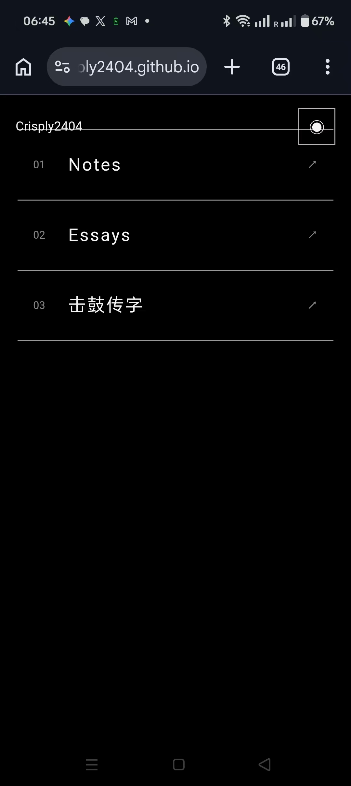

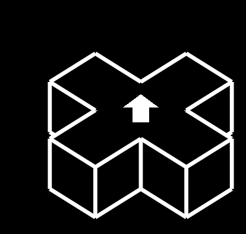

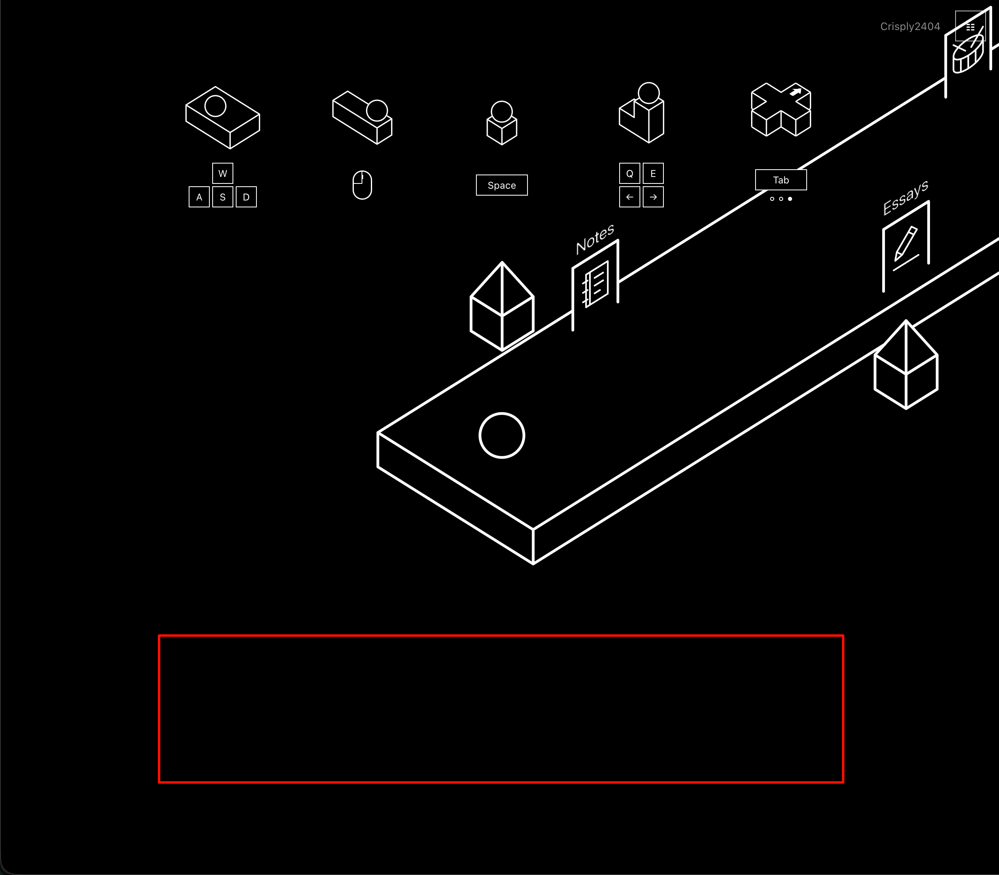

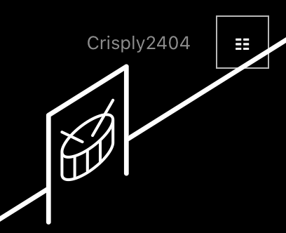

### 用户消息 · 07:05

7.我觉得门名的字体可以稍微粗一点，还有教我自己调的办法，我可以一边调一边看看多粗最适合

### 助手最终回复

- 单指与双指提示使用同系列 Tabler 手势图标，动画保持黑白风格。
- 手机默认放大 1.5 倍，范围为 1–3 倍；平移与旋转保持整个球体可见。
- 网页顶部栏与形态切换按钮采用不透明背景，按钮位于最前图层。
- 桌面刷新默认采用朝上的控制模式；提示移至底部，间距随屏幕高度调整。
- 门名字重调整为 500，支持即时修改。

自己调整时，运行 `npm run dev`，打开本地网页。在浏览器开发者工具中选择 `<html>`，编辑 `--door-title-font-weight`，尝试 `400`、`500`、`600`、`700`；门名即时更新。选定后，将数值保存到 [styles.css](/Users/hco/Documents/Crisply2404.github.io/src/styles.css:11)。[完整说明](/Users/hco/Documents/Crisply2404.github.io/docs/door-typography.md)。

检查通过，已统一提交并发布；聊天原文与五张图片已归档。

### 用户消息 · 07:24

你这个击鼓传字门的图标是你自己手画的？我怎么感觉这个角度看着不均匀啊，三根线偏左了，不在正中间，你能不能直接1:1把chuanzi的favicon的线条弄来这，还是你已经做到了，就是视角问题

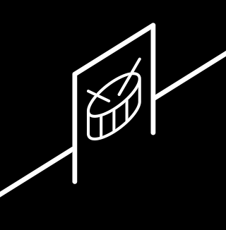

### 用户消息 · 07:27

还有，我进了notes门然后打开了notes页面之后点了浏览器的后退，然后回到了游戏页面，但是这之后就没法进入其他门了。还有notes和essays的图标太儿戏卡通，我要符合我们设计美学的图标。

### 助手最终回复

浏览器后退后可以继续进入其他门；返回走廊时球体位于起点。

Notes、Essays 图标已改为几何笔记页与展开书页，保持黑白线框、统一线宽和正常遮挡。

击鼓传字使用原 favicon 的完整 SVG，三根线等距且居中，投影间距检查通过。

浏览器回归、物理、GPU、构建与两项审查均通过。

### 用户消息 · 07:50

我觉得essays的图标得换一个，这里的essay是随笔的意思，你这图标整的像论文或者书。还有击鼓传字门的图标是看着不均匀啊，三根线偏左了，不在正中间，怎么办，虽然好像就是视角导致的，图像本身没问题

### 用户消息 · 07:54

没有必要每次都发新issue，小的改动可以接着用上次的issue，合并进去就行了。还有我觉得还是不要每刷新一次默认进去都是W向上操控模式，还是改回原来那样吧

### 助手最终回复 · 08:08

控制模式已恢复保存上次选择，刷新后继续使用；提示动画随当前模式变化。相关小改动沿用现有 Issue，本轮合并到 #9。

Essays 已换成笔尖与连贯笔迹。

击鼓图标三根线的实际间距相等，原图斜视鼓面叠加门板投影会影响观感。要改善这种观感，需要使用正视鼓形，再由门板产生倾斜；本轮保留原 SVG。

已发布，线上模式保存和后退进门检查通过。

### 用户消息 · 08:11

我觉得essays只保留笔记就挺不错的，都不用那支笔

### 助手最终回复 · 08:20

Essays 已只保留连贯笔迹，居中显示。已经发布，浏览器与线上检查通过。

### 用户消息 · 08:39

`ask-matt` 能不能让小球在进入门触发跳转的时候马上把小球停下来不许移动，防止明明都触发要跳转了玩家还在操控小球接着走。还有，现在我们的github issue是作为什么作用？matt里有说吗，你觉得我们项目用github issue还是本地md文档更好？说说原因。matt应该没有这两者之外的做法了吧

### 助手最终回复 · 08:59

小球现在会在触发入口的当帧停止，清除输入与寻路，等待跳转期间保持原位；浏览器后退后恢复操作。已发布，桌面、手机和线上返回检查通过。

当前 GitHub Issue 用来记录功能需求、验收条件、进度和验证结果，并关联提交。Matt 的 `to-tickets`、`implement`、`code-review` 会使用这些任务记录；本次继续合并到 #9。

**我更推荐我们目前使用本地 Markdown 记录任务**：项目由你个人维护，需求主要来自持续对话，相关小改动经常合并，任务与代码一起保存和提交更方便。GitHub Issues 的优势是公开反馈、多人讨论，以及关联 PR。聊天原文、领域定义和设计决定继续由各自的仓库文档保存。

Matt 在 `setup-matt-pocock-skills` 中明确支持 GitHub、GitLab、本地 Markdown，也支持 Jira、Linear 等自定义工具。本地任务默认放在 `.scratch/<feature>/issues/`。目前仓库仍使用已配置的 GitHub Issues。

### 用户消息 · 08:59

手机端的单指点击和双指的操作提示动画还不如改回原来那样，注意手指的边框线条也要改细。

### 助手最终回复 · 09:29

已恢复手机端原来的单指点击、双指缩放和平移提示动画，手指外框与内部线条均调整为 1 像素。

已发布，手机动画、浏览器操作和线上检查通过。

## 2026-10-13

### 用户消息

`ask-matt` 1.我希望把网页版的这个每个标题的分割线以及序号以及最右侧的那个指向右上角的箭头全部去掉，只需要鼠标经过对应的地方反色就行
2.我还希望把原来每个标题序号的部位改成游戏中的球，鼠标滑到哪个标题我们的小球就跟着滑到哪个标题的前面，然后这个滑动不要是匀速的，最好是先快后慢的。
3.我觉得可以着手开始做我们个人网页的游戏版的联机，你觉得应该用什么来提供联机服务？调研一下什么联机服务免费而且稳定的

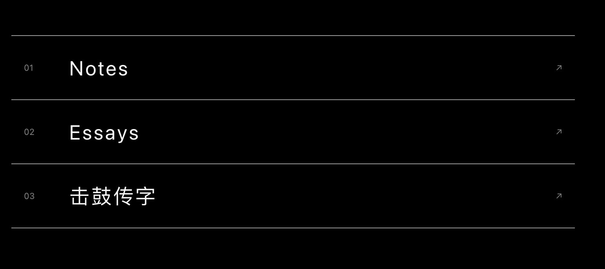

### 用户消息

4.还有我觉得应该在我们这个crisply2404.github.io的仓库git ignore掉chuan-zi，不要把chuan-zi的源码泄露到我们对个人网站的提交里面

### 助手最终回复 · 01:21

1. 网页入口已发布：移除分割线、序号和箭头，鼠标经过时反色；原游戏小球跟随标题移动，开始较快、接近目标时减速。
2. `chuan-zi/` 与构建源码目录均已加入 `.gitignore`，核查确认主站提交没有这些源码。
3. 联机推荐 **Cloudflare Workers + Durable Objects + WebSocket Hibernation**。免费额度适合当前个人网站：按 10 Hz 发送，10 人每天同时移动 10 分钟约消耗 3,000 次计量请求，免费额度为每天 100,000 次。空闲时可保持连接。

免费方案没有可用性 SLA，中国大陆连通性尚未实测。完整依据见 [联机调研](docs/research/free-presence-hosting.md)。

本地与线上检查通过，本轮统一提交为 `35998e1`，沿用 Issue #9。

### 用户消息

我们的macOS开了“减少动态效果”，导致看不到我们的小球动画，我希望不要被任何平台的任何设置影响导致看不到我们的动画。

### 助手最终回复 · 01:40

已发布。开启 macOS 或其他平台的“减少动态效果”后，小球仍播放完整的 420 毫秒动画，保持先快后慢的移动。

本地与线上均通过三个屏幕尺寸、两种动态效果设置的检查。

### 用户消息

1.联机就用你说的方案。
2.还有我希望网页版的时候，光标能变成游戏元素中的正方体加顶上一个刺的形态，然后可以不让原来的光标显示。
3.网页版也是可以按wasd移动小球，qe或者方向键旋转的，和我们游戏版的操作一样，这算是一个知识锁，而且碰到我们的光标的刺的部分会碎掉，碰到方块的部分会推走，不过光标移走后小球会在最近的标题前位置重生。当然操作后高亮的话小球还是得滑到它本来在的标题前的位置。
4.如图1，按tab出来的提示和操作提示隔得有点近，还是把操作提示放屏幕上边吧

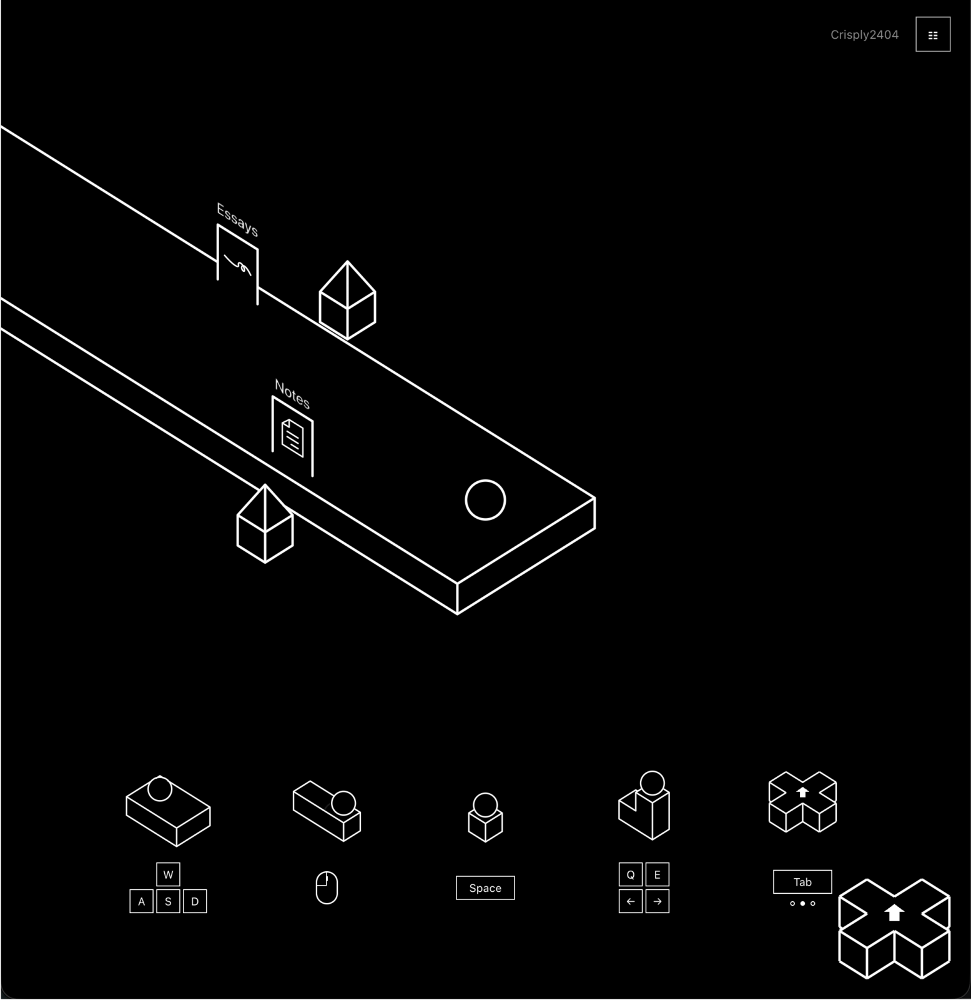

### 助手最终回复 · 02:45

已发布网页修改：游戏方块加尖刺光标、WASD 移动、Q/E 与方向键旋转、尖刺破碎、方块推动、最近标题前重生，以及顶部操作提示。线上检查通过。

Cloudflare 联机已实现并通过本地二十个连接与两个浏览器验证。正式上线需要账号登录：

```sh
cd /Users/hco/Documents/Crisply2404.github.io/presence
npm exec wrangler -- login
```

完成浏览器授权后回复“已登录”，我会继续部署并连接主站。

### 用户消息 · 03:37

Cloudflare 发布需要账号登录。本机 Wrangler 报告尚未认证。请在终端运行 `cd /Users/hco/Documents/Crisply2404.github.io/presence && npm exec wrangler -- login`，在打开的 Cloudflare 页面完成登录并授权，然后回复“已登录”。我会继续完成代码和验证，登录后直接发布。

已登录。然后，在个人网站的网页版，我希望qe旋转的时候能每个元素自转，而不是围着一个莫名其妙的点旋转。然后我希望网页版的光标也能像球那样在反色部分的部分反色。

### 助手最终回复 · 03:53

联机已上线并连接主站，可以实时看到其他访客的小球。

Q/E 旋转保持各个元素自身中心，小球当前位置保持不变；光标跨越黑白区域时局部反色。

线上联机、自转、反色和入口动画检查全部通过。

### 用户消息 · 04:12

`ask-matt` 1.为什么我还能看到chuan-zi里面的更改，好像在我们这个仓库不应该看到吧。还有我们的击鼓传字更新了，你是不是应该build pages一下，注意别动chuan-zi里面的东西。
2.我希望电脑端按回车可以打字输入东西然后说话，说话的方式就是在小球正上方弄个对话框，在对话框里面输入完后回车就可以发出，手机点按自己的小球也可以弹出对话框对话，注意手机和电脑弹出和收回对话框都要有补间动画，而不是瞬间弹出瞬间收回。按下后可以输入想说的话。这是保证一个人说话不要所有人都能看到的方式，离得远就应该看不到。顺便应该更新一下手机和电脑的操作提示，加入对话的操作提示。
3.我希望我们的小球的hitbox完全不变，但是在摄像头面前可以保持成一个时刻面向摄像头的和现在看起来完全一样的圆形贴图，这样比较省事。注意不要理解错我的意思，你如果有疑问就应该问。
4.在没有改变高亮项的时候应该允许光标的方块那侧推开小球，而不是一直让小球复原到标题前。还有我注意到小球在高亮框外碰到光标的方块（虽然是光标方块主动移动去碰小球）会直接复原到标题前，我希望也是被推开。

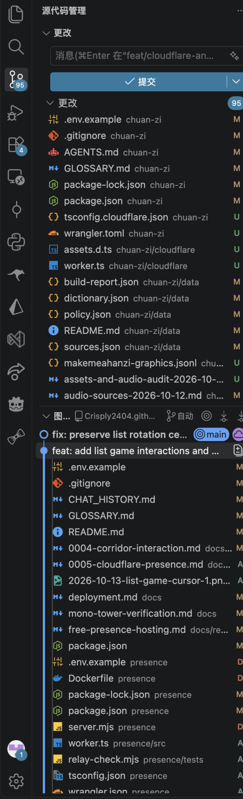


### 用户结构化回答 · 04:53

关于第三项：当前球体已经使用始终朝向摄像机的平面，并由 shader 绘制正圆。你是否希望改用预生成的黑色内部、白色轮廓圆形贴图，同时保留半径 20 的球体 hitbox、球面深度遮挡，以及缩放后的相同外观？

好吧，当前平面shader满足我的意思，不过我看球在经过不透明的门的时候会被部分遮挡，我希望对付这种贴图的遮挡，球的中点被门遮挡的话那就全部球被遮挡，而中点不被遮挡就全部不被遮挡。

近距离对话是否采用这些规则：只在游戏形态联机走廊使用，范围为 6 个方块（240 世界单位）；发送后显示 8 秒，每次最多 120 字，只显示最新一条；聊天内容仅向范围内访客发送，服务不保存历史。

使用这个规则。但你如何确定哪些访客在范围内。

击鼓传字的 GitHub 私有仓库目前只有旧的 main，本地新功能在 `feat/cloudflare-and-room-polish` 分支且还有未提交内容。你希望这次 Pages 发布哪份版本？两种方式都保持本地 chuan-zi 文件原样。

等私有仓库更新后，由 Actions 构建发布

对话框放在哪种形态？

只在游戏形态显示，消息按 240 世界单位发送给附近在线访客

击鼓传字 Pages 构建源

等我把当前本地更新提交到 chuan-zi 的远程分支后，再让主站 Actions 构建

击鼓传字构建产物中的 glyphs-source.zip 包含两个生成脚本。你要求源码保持私密，是否只排除这份下载包，其余产物正常发布？排除后网站现有的“原始资料、修改资料与生成源文件”下载链接会暂时不可用；chuan-zi 原目录保持原样。

让我考虑一下，因为我不知道这个下载包是干嘛的

### 助手最终回复 · 05:18

- `chuan-zi` 的更改来自它自己的嵌套 Git 仓库。主站没有跟踪其源码，工作区已配置忽略显示。
- 游戏形态已支持 Enter 输入和发送、手机点按自己的球体，打开与收回都有补间动画，操作提示也已更新。
- 附近访客按最新球体坐标的三维距离判定：不超过 240 世界单位才接收消息，显示 8 秒，服务不保存历史。
- 门遮挡球心时整球隐藏，球心未被遮挡时整球显示；hitbox 保持不变。
- 光标方块推动后保持位置，切换高亮入口时才恢复。

已发布 `6ec2804`，本地与线上检查通过。使用 Matt 的 `implement` 和 `code-review` 完成实现与审查。击鼓传字等待你更新私有远程；`glyphs-source.zip` 是汉字资料、许可与两个生成脚本的下载包，公开范围仍待你决定。

### 用户消息 · 2026-10-13

`ask-matt` 使用合适的matt skill执行：1.手机的操作提示的发消息没有表达出要点按自己的球体才能发消息的意思，看着跟最左边的单指点击没啥区别。
2.手机端的网页版的球应该保留点按移动的操作方式。
3.网页版只有W朝上这一种操作模式，并且和游戏版的w朝向不互通。网页版取消tab的功能。
4.进入每一页后球默认出生在标题前，比如进入notes页之后球就出现在notes前，然后可以移动，可以把字给推走，要求是每个字母都可以按任意角度被推走，而且滑到网页下面再滑回去不会看到推走的字和球被复原回原位，保持这个状态除非整个页面刷新。这个需求比较重要你有不懂的可以问我。

### 用户结构化回答

Q1 可推动文字范围：是否包含主页三个入口标题、Notes/Essays 分类标题，以及文章标题；正文和左上角 Crisply2404 保持阅读布局？中文标题也按每个汉字独立推动。

所有页面文字都能推动

Q2 推动效果：每个字母是否作为独立物件，在网页平面中自由平移、按任意角度旋转，并与小球和其他字母发生真实碰撞，停止后保留位置？

确认这些规则

Q3 状态保存：是否让每个 URL 保存自己的球体与字母位置，滚动、尺寸变化、切换形态以及前进后退都恢复该页面状态，浏览器刷新才恢复初始布局？主页换高亮入口时，小球继续跟随新入口，已经推动的文字保留位置。

使用这些规则

### 用户结构化回答

网页文字已经可以逐字移动与旋转。状态按每个 URL 保存，滚动、尺寸变化、切换形态和前进后退保留，刷新恢复。现有链接继续可点击，移动后的链接文字也能打开原目标；左上方站点文字跟随固定顶部栏。是否符合你确认的含义？

符合，按这些规则完成

### 助手最终回复

- 手机发言提示直接演示点按自己的球体，随后展开对话框。
- 手机网页支持点按移动；网页控制固定 W 朝上，与游戏设置独立，Tab 保留浏览器导航。
- 阅读页小球出生在标题前，全部文字逐字参与推动、自由旋转和碰撞。
- 每个 URL 保存球体与文字状态，滚动、尺寸变化、切换形态和前进后退保留，刷新恢复。

提交 `c23d06d` 已发布，本地与线上检查通过。使用 Matt 的 `implement` 和 `code-review`，继续沿用 Issue #9。

### 用户消息 · 2026-10-13

1.我发现有的时候字母之间有碰撞体积，有的时候没有，这是怎么回事？
2.球的图层应该比顶部栏前，不然顶部栏的不透明部分会遮挡住球。
3.球被刺扎到碎掉每次都应该随机不同碎法。这个你可以具体问我。
4.网页前进和后退应该具有跟刷新一样的效果，恢复。
5.右上角那个切换网页和游戏形态的按钮，对于刚进来的没有点过一次这个按钮的人应该提示一下，这个按钮可以切换到网页形态。就在那个按钮下面提示，最好有补间动画，不要太生硬出现提示。

### 用户结构化回答

小球随机碎法采用哪种效果？我建议保留黑白圆周，在每次碰到尖刺时随机产生 6–12 段长度不同的圆弧，随机散开方向、距离和旋转速度，约 280–420 毫秒消失；尖刺离开后按原规则重生。

采用随机圆弧碎片（推荐）

### 用户消息

5.还有个bug，我发现我在网页打开之前悬停到notes那栏的话那个Notes文字会直接不见，我明明都没推它。

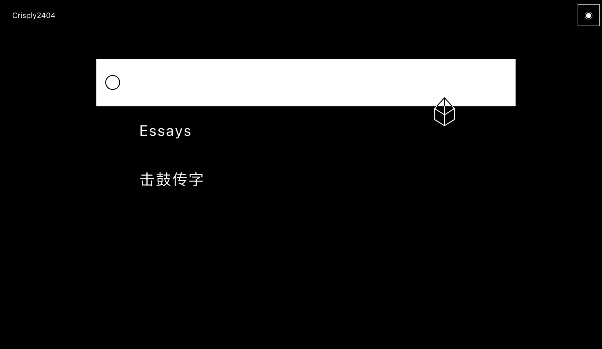

### 助手最终回复

- 字母碰撞失效来自三维碰撞选择了被锁定的深度方向，以及快速移动时接触处理不足；已使用二维物理修复，三种速度下最大重叠小于 0.6 像素。
- 小球现在显示在顶部栏前方。
- 每次破碎随机生成 6–12 段圆弧，长度、轨迹、旋转和持续时间均随机。
- 前进、后退和刷新恢复初始布局；滚动保留位移。
- 首次形态切换提示在按钮下方补间出现，点击一次后不再提示。
- 加载前悬停导致 Notes 消失的问题已修复。

提交 `3475547` 已发布，本地与线上检查通过。聊天原文和截图已保存，继续沿用 Issue #9。

### 用户消息 · 2026-10-13

我的chuan-zi仓库应该是push了的，为什么我们网站的GitHub action没触发更新？注意别动传chuan-zi里的东西

### 助手最终回复

你确实已经 push，远程 `main` 当前是 `6c5e810`。没有更新有两个原因：

1. 主站 Actions 只监听主站的 push 和手动运行，击鼓传字仓库的 push 不会触发它。
2. `CHUAN_ZI_REF` 仍固定在旧提交 `0d80069`，手动运行也会构建旧版。

旧版本继续固定，是因为你此前尚未决定是否公开 `glyphs-source.zip` 中的两个生成脚本。新版本已在主站忽略目录中的独立副本成功构建；本轮未修改 `chuan-zi` 文件，也未发布新版本。

### 用户消息 · 2026-10-13

那个zip本来就是要公开的是吧，如果是的话那就公开，如果不是我再考虑

### 助手最终回复 · 2026-10-13

是，这个 zip 原本就是“数据与许可”页面提供的公开资料包，包含字形资料、许可和两个生成脚本。

已经公开，并发布了击鼓传字最新版本 `c33eaf2`。页面、zip 下载和联机连接均通过验证，原 `chuan-zi` 目录保持原样。

### 用户消息 · 2026-10-13

1.如图1，我认为手机版的发言提示动画看上去不好，应该是手指从右下去点击，带个角度，而不是手指直接向下。
2.我发现电脑版的wasd移动的操作提示的按键有时候会闪烁，不知道什么原因，就是本来按着a往左移结果a那个键突然闪黑又回到白色
3.如图2，我认为点击输入框外的地方应该可以退出对话框，而不是必须在没有输入的情况下按回车才能退出对话框。
4.如图3，右上角的按钮的字符下移了，我不知道为什么。
5.如图4，我发现手机版这个球很容易就会移动然后撞字，比如我想要去选择一段文字复制，结果我点了其他地方取消掉选中，结果这球就自己跑来撞字了。我不希望手机版这么容易触发球的移动。其实我不太清楚手机版应该怎么处理。你可以问我问题

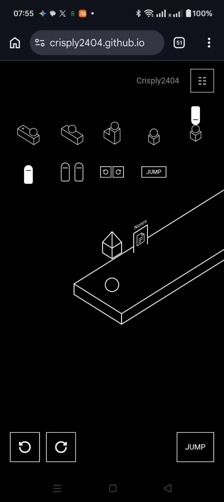
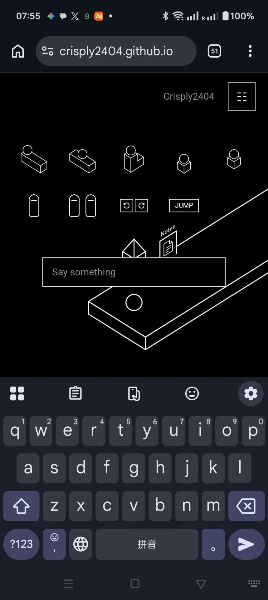
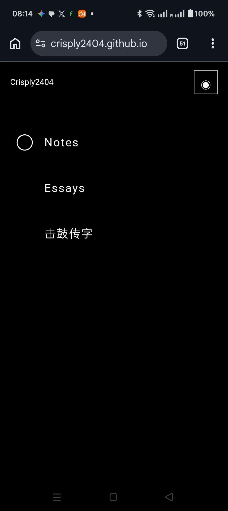
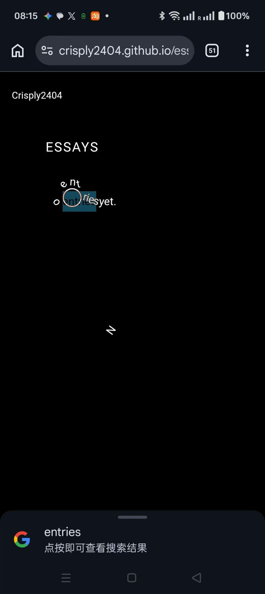

### 用户结构化回答

手机网页的小球移动采用哪种方式？我建议只允许从小球上开始拖动，松手后球体走向松手位置；页面其他点击、取消文字选择和滚动都不触发移动。

从小球开始拖动（推荐）

### 用户消息

6.还有，手机上网页版的恢复原始布局不灵敏，手机上前进后退或者刷新，或者点进地址栏然后回车（应该也是刷新的功效），都应该恢复原始布局，而不是还是被球撞散的布局

### 用户消息

7.我认为switch to webview应该在我红线那里弄个尖角指向按钮，不然没法第一眼知道这个提示是提示右上角那个切换形态的按钮的

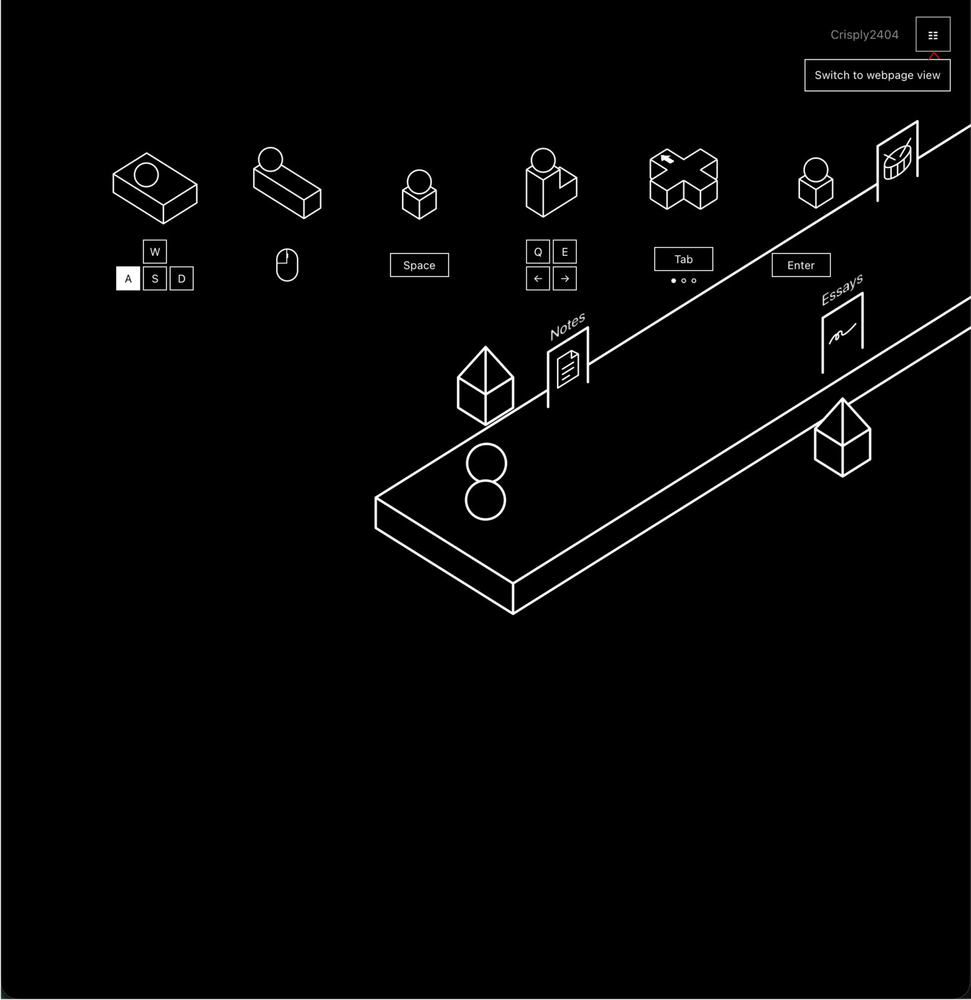

### 用户消息

8.我认为短时间内连续说多条话应该是把前一条话用自然的补间动画顶上去然后下面冒出新的话，然后每个对话框分别计时消失时间。

### 助手最终回复 · 2026-10-13 18:44 Asia/Shanghai

连续发言现在会保留多个对话框：新消息从下方展开，已有消息平滑上移，每条独立显示 8 秒后淡出。

本轮其余修改也已发布：

- 手机发言手指从右下方接近，WASD 提示持续高亮。
- 点击输入框外部补间关闭，按钮字符位置恢复正常。
- 手机网页从小球开始拖动才能移动；前进、后退、刷新及同地址进入恢复布局。
- 切换提示加入指向按钮的尖角。

统一提交 `e743c16`，本地与线上检查均通过，继续使用 Issue #9 记录。

### 用户消息 · 2026-10-13 Asia/Shanghai

1.我觉得手机的小球移动直接用手指拖动小球是对的，但还有一个要改进的地方就是，我觉得小球可以直接实时跟着拖动它的手指走，而不是每次拖只能走直线
2.聊天记录助手回复只保留每次一轮对话最终回复（一轮指的是从我到你再到我之前，注意steer的部分也算在一轮里面，而不是额外算一轮），而且当我引用skill不用保存具体skill.md，你只需要把引用的skill给到就行。

### 用户消息 · 同轮 steer

第二点我的意思是，你只需要把引用的skill是什么名字给到就行。

### 助手最终回复 · 2026-10-13 20:52 Asia/Shanghai

手机网页的小球已实时跟随手指拖动，可以连续转向并推动文字，松手立即停止。已经发布，本地与线上检查通过。

聊天记录已整理：每轮只保留助手最终回复，steer 归入同一轮，skill 仅记录名称；用户原文与图片继续保留。规则已写入 AGENTS.md。

### 用户消息 · 2026-10-16 Asia/Shanghai

1,我希望把游戏版的切换网页版形态的按钮左边的我的名字点击后直接导航至我的github主页。然后在网页版我也希望切换回游戏版的按钮左边能多一个github图标的按钮，点击后能到我的github主页。
2.有的时候直接进入网页版（因为上次是进入了网页版后退出，浏览器记住了我的选项）的时候光标和小球都没有加载出来
3.如图1，网页版的光标的线条和小球的线条交汇到一起会反色。我希望首先不要反色，然后最好不要在这两个碰撞的时候让这两个的线条交汇到一起（hitbox包括线，但刚好贴合，不要让这两个碰在一起的时候中间有缝隙，你觉得有歧义可以问我）。
4.我希望我们的光标可以像打高尔夫球一样把小球击飞（光标运动时撞击小球符合动量定理，但光标别被反冲）
5.我希望可以放个Work选项，然后点击这个work选项可以用丝滑的补间动画展开，里面有“击鼓传字“这个选项。你觉得有歧义或者设计上我的描述不够精确可以问我。

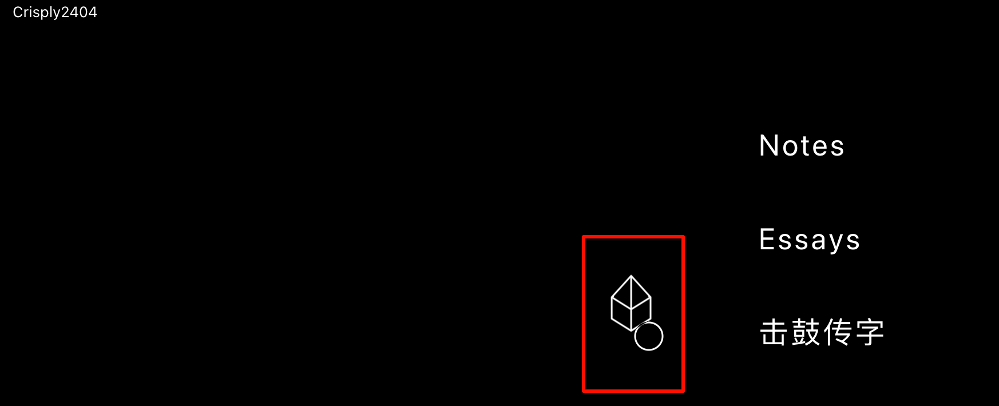

### 用户结构化回答 · 同轮 steer

问题：Work 入口范围：请选择：只在网页版列表中把“击鼓传字”收进 Work，游戏走廊继续保留击鼓传字门（推荐）；游戏版与网页版都使用 Work，游戏走廊也显示 Work 入口。

回答：网页版收进 Work，游戏门保留

问题：Work 展开方式：请选择：点击 Work 后在原位置向下展开子入口，使用高度与透明度补间，再次点击收回（推荐）；点击 Work 后展开为整页项目列表，再次点击返回。

回答：原位置向下展开

### 助手最终回复 · 2026-10-16 01:41 Asia/Shanghai

- 游戏形态的名字连接 GitHub；网页形态在切换按钮左侧增加 GitHub 图标。
- 网页直接进入与刷新时，光标和小球正常显示。
- 光标与球体交汇时保持原有颜色，碰撞范围包含线宽，接触时相切。
- 光标移动越快，击球速度越高；球体继续运动并逐渐减速，光标保持鼠标位置。
- Work 在原位置平滑展开、收回“击鼓传字”；游戏走廊保留击鼓传字门。

已统一提交并发布。本地与线上浏览器检查通过，继续使用 Issue #9，聊天原文与图片已归档。

### 用户消息 · 2026-10-16 Asia/Shanghai

这个看着没有展开的感觉啊，看上去就是换行加个缩进而已，想想怎么才能表现展开的感觉，同时维持极简风。

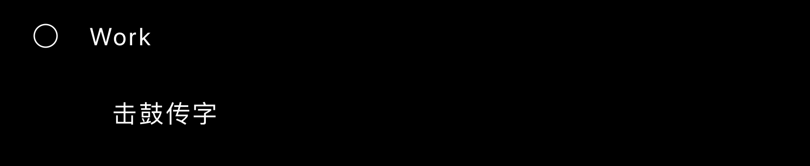

### 助手最终回复 · 2026-10-16 01:50 Asia/Shanghai

已经调整了 Work 的展开表现：

- Work 左侧使用加号，展开后变为减号。
- 子项目从 Work 下方展开。
- 左侧增加纵向引导线和横向分支线，表现清晰的层级关系。
- 引导线、透明度和高度同步补间。
- 保持黑白、无卡片、无多余装饰的极简风格。

已提交 `e250c32` 并发布到 GitHub Pages。线上 `test:work-profile` 通过。

### 用户消息 · 2026-10-16 Asia/Shanghai

能弄个可以跟球对齐的设计不，感觉跟球都没对齐，不够爽。是否有比纵向引导线和横向分支线更好的方式

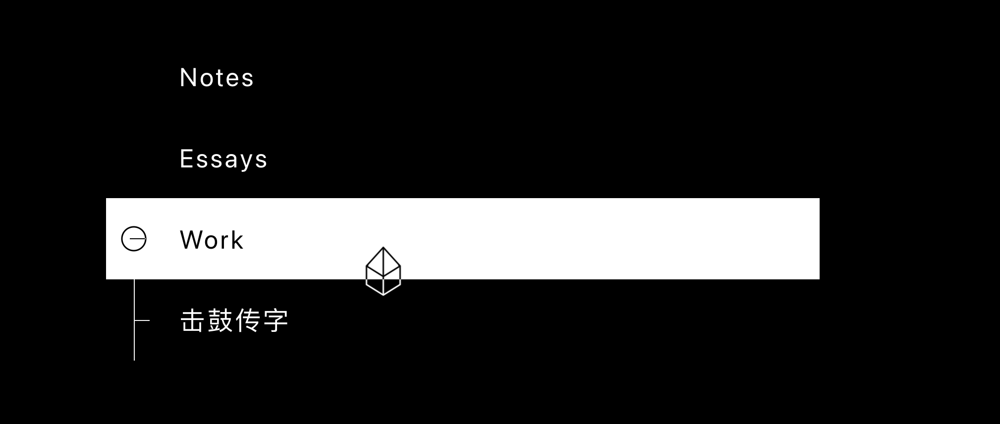
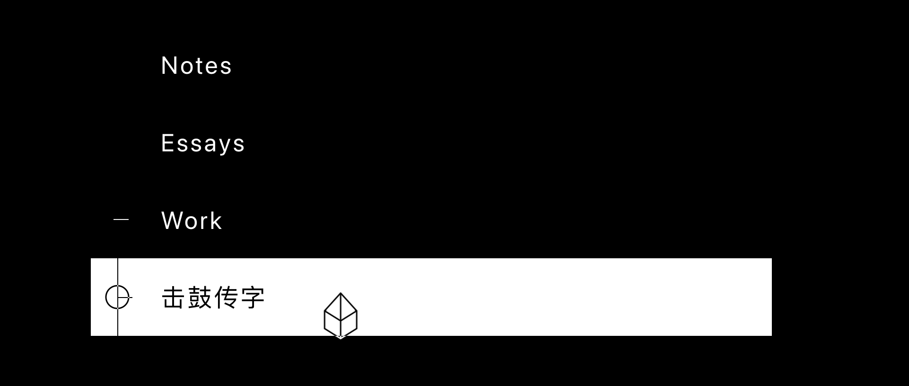
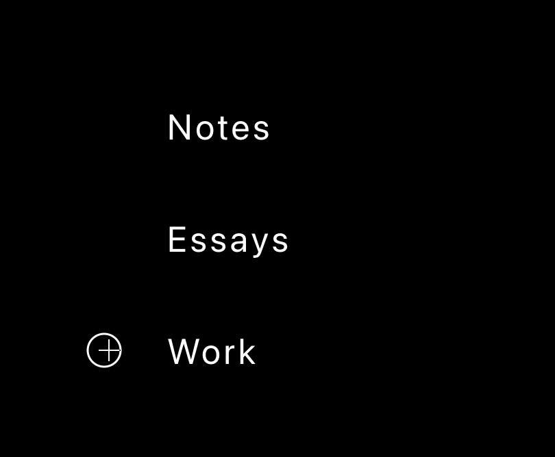

### 助手最终回复 · 2026-10-16 05:10 Asia/Shanghai

我更推荐**球体选择栏＋Work 右侧的小型空心三角**：

- 球体独占左侧，所有入口前的球心都位于同一条竖直线上，并与当前行文字垂直居中。
- 三角紧跟 Work 文字，中心高度与球心一致；收起朝右，展开时平滑旋转朝下。
- 击鼓传字与其他标题共用文字起始线，字号略小，与 Work 的距离更紧凑，表达从属关系。
- 展开时下方空间连续撑开，子项目向下滑入并渐显；收回时反向播放。

### 用户消息 · 2026-10-16 05:14 Asia/Shanghai

“击鼓传字与其他标题共用文字起始线，字号略小，与 Work 的距离更紧凑，表达从属关系。“，这个会不会破坏ui的一致性？

### 助手最终回复 · 2026-10-16 05:14 Asia/Shanghai

会削弱目前列表的一致性，尤其是字号和行距同时变化时。

击鼓传字应继续使用相同的字号、字重、行高、间距和文字起始位置。Work 右侧的三角与展开动画已经能够表达层级，球体也能保持统一的排列与移动距离。

### 用户消息 · 2026-10-16 05:47 Asia/Shanghai

但我觉得可以用对齐球中心的纵向引导线

### 助手最终回复 · 2026-10-16 Asia/Shanghai

纵向引导线已与球心共用同一条轴线，球体会遮住身后的线段。各个入口保持统一字号与间距，引导线随展开和收回平滑伸缩。

已发布，桌面与手机检查通过。

### 用户消息 · 2026-10-19 Asia/Shanghai

我希望能把[https://github.com/Crisply2404/Hockey](https://github.com/Crisply2404/Hockey)也接到我们的项目，这项目我们之后会自己完善，不过我们先给它一个入口。你可以clone到我们的工作目录然后排除在我们个人网站的git之外。然后这个也是放work里面的。

### 助手最终回复 · 2026-10-19 Asia/Shanghai

Work 已加入 [Hockey](https://crisply2404.github.io/hockey/)，已发布。

项目克隆在 [Hockey](/Users/hco/Documents/Crisply2404.github.io/Hockey)，已被主站 Git 忽略。主站只发布构建产物。

桌面与手机检查通过。本地模式可用，联机服务尚未配置。
