# Chat history

> 日期与时间使用 `Asia/Shanghai`。本记录保存公开消息、有效问题与回答，以及收到的图片附件。

## 2026-10-10 06:20

### 用户消息 1

[$setup-matt-pocock-skills](/Users/hco/.agents/skills/setup-matt-pocock-skills/SKILL.md) [$grill-with-docs](/Users/hco/.agents/skills/grill-with-docs/SKILL.md) 我希望在当前crisply2404.github.io这里做一个我的个人网站，但这个博客的主页比较有趣，它直接借鉴我的一个游戏：/Users/hco/Documents/GodotProjects/mono-tower/，我希望你能在不要动这个游戏的情况下一比一复刻到我的个人网页，除了暂停页，因为网页不需要暂停，当然地图也不用刻意复刻，甚至对于blog来说地图应该简单一点，就是直接一个直的过道然后两边把入口门放上就可以，以后还能接着延长这个过道然后两边放门，像那种酒店的过道一样。然后我希望博客的主页也可以展示其他来这个网站的人，它们也会变成这个游戏里的一个球，然后是可以实时看到其他正在浏览我的网站的人在我网站里是怎么移动的，然后每个门相当于是我的个人网站的各个地方的入口，比如一个是notes的入口，一个是随笔的入口（不知道英文叫什么，反正就是随心所想写下来的文字），一个是我做的网页联机游戏“击鼓传字“[https://github.com/Crisply2404/chuan-zi](https://github.com/Crisply2404/chuan-zi)的入口，当然这个项目其实已经在我们的目录里面，但我不希望你把它push到我们个人网站的仓库，因为这个仓库是一个私密仓库，但我又希望个人网站能通到这个项目，因为我想借用github的域名。不知道chuan-zi是不是应该作为一个我们个人网站的submodule，还是说有什么更好的方式。你不需要也不应该去修改chuan-zi，而是把我们个人网页到chuan-zi的连接做好。
还有，请把我们双方的聊天记录写在一个md里面，尤其是要把我说的消息原文+图片保存，并把这个规则记录到agents.md。

图片附件：无。

### 助手最终回复

个人网站已经完成并发布：

- 网站地址：[https://crisply2404.github.io/](https://crisply2404.github.io/)
- GitHub 仓库：[Crisply2404/Crisply2404.github.io](https://github.com/Crisply2404/Crisply2404.github.io)
- 主页默认进入 Three.js 游戏形态，保留黑白线框、正交镜头、球体、键盘、触控、跳跃、旋转和安全鼠标寻路；页面按钮可以切换到普通列表形态，选择会保存在浏览器。
- `notes`、`essays`、`chuan-zi` 已作为走廊门与列表入口。`notes` 和 `essays` 从 `src/content/` 读取 Markdown，当前显示空状态。
- `chuan-zi` 源代码目录已被 `.gitignore` 排除。GitHub Actions 使用 `CHUAN_ZI_TOKEN` 读取私有仓库，构建后的 `dist` 发布到 `/chuan-zi/`。
- presence relay 位于 `presence/`，本地健康检查和真实 WebSocket 广播已验证。线上 WSS 地址尚未配置，因此线上访客球暂时保持本地模式；部署 relay 后设置 `VITE_PRESENCE_WS_URL` secret 即可启用。
- 聊天记录保存在 `CHAT_HISTORY.md`，图片归档规则保存在 `AGENTS.md`，图片目录为 `docs/chat-assets/`。本次没有收到图片附件。
- triage 配置已按你的决定省略，GitHub Issues 与单一上下文领域文档已写入 `docs/agents/`、`GLOSSARY.md` 和 `docs/adr/`。

验证已完成：`npm run check`、`npm run build`、Playwright 桌面与移动端页面检查、presence `/health` 和 WebSocket 广播检查均通过；GitHub Actions 部署成功，Pages 状态为 `built`，根站、`/notes/`、`/essays/` 和 `/chuan-zi/` 均返回 200。

## 2026-10-10 06:43 至 07:10

### 助手公开消息

已接受确认，并记录两项调整：省略 triage 配置；主页增加普通网页形态，默认仍进入游戏形态，列表形态继续使用游戏的黑白视觉。普通形态会加入设计树，需确认切换方式、入口打开方式和 presence 范围后开始编辑。

最后三项已确定：页面内按钮切换形态并保存选择，首次访问进入游戏形态；列表形态按顺序列出 `notes`、`essays`、`chuan-zi`，前两者当前页打开，后者进入 `/chuan-zi/`；列表形态退出 presence lobby。现在开始编辑网站、聊天记录、`AGENTS.md`、领域文档、构建工作流和部署文件。triage 文件与 `AGENTS.md` 对应段落会省略。

基础工程文件、样式、环境变量模板和目录已经写入。接下来加入 Three.js 场景、固定步长物理、导航图、访客 relay、Markdown 页面和形态切换；这些代码会保持 `chuan-zi` 源目录为忽略内容。

首次类型检查发现两处可定位问题：门点击的筛选回调返回了可选对象，页面根节点的类型缩小没有跨越闭包。现在修正这两处，再继续构建和运行验证。

类型检查和生产构建已经通过。现在启动本地 Vite 服务，检查首页、列表形态、Markdown 路由和 WebGL 初始化；同时安装并检查 presence 服务的独立依赖。

页面行为检查通过：主页有 WebGL canvas，列表形态有三项入口，`notes` 空状态路由正常，控制台没有页面异常；presence `/health` 和真实 WebSocket 广播也通过。发现内容页销毁场景时 presence 的关闭事件会安排重连，这会让列表形态重新加入 lobby，我正在修正这一生命周期问题。

本地来源修正后复测通过：presence 服务收到主页访客，切换到列表形态后在线访客数量立即回到零；页面没有运行时异常。接下来初始化公开主站仓库，确认 `chuan-zi` 源目录、依赖和构建输出都不会进入提交，然后创建 GitHub 仓库并发布。

公开仓库已创建并推送到 `https://github.com/Crisply2404/Crisply2404.github.io`，提交内容不包含本地 `chuan-zi` 源目录。现在配置 Pages 使用 GitHub Actions，并检查首个工作流状态。

Pages 的工作流成功，但站点仍由仓库根目录的 legacy source 提供旧入口，导致公开页面继续引用 `/src/main.ts`。我会把 Pages 发布源改为 Actions artifact，再复查根路径和 `/notes/` 的实际内容。

Pages 的 404 fallback 能显示应用内容，但 HTTP 状态仍为 404。为了让入口地址本身可访问，我会把 `/notes/` 和 `/essays/` 作为 Vite 的真实 HTML 入口生成；文章数量为空时无需额外页面，未来文章仍可通过应用内列表进入。

主站已切换到 Actions artifact，线上根路径、`/notes/`、`/essays/` 和 `/chuan-zi/` 均返回 200；无截图页面检查通过，WebGL canvas、列表入口和空状态都正常。剩余部署项是 presence relay：代码已完成并本地验证，公开 WSS 地址尚未配置，因此线上访客广播当前保持关闭。

线上功能已稳定，补充检查发现网页输入还缺少游戏中的左右方向键别名。现在加入 `ArrowLeft`/`ArrowRight`，并重新运行类型检查、构建和线上工作流。

图片附件：无。

用户同时提供了 `setup-matt-pocock-skills` 与 `grill-with-docs` 的 skill 原文；skill 文件路径分别是 `/Users/hco/.agents/skills/setup-matt-pocock-skills/SKILL.md` 和 `/Users/hco/.agents/skills/grill-with-docs/SKILL.md`。其中 `grill-with-docs` 要求调用 `grilling` 与 `domain-modeling`，`setup-matt-pocock-skills` 要求探索仓库、确定 issue tracker、确定 triage 标签、使用单一上下文领域文档并在写入前展示草稿。

### 助手公开消息

我会使用你指定的 `setup-matt-pocock-skills` 和 `grill-with-docs`，同时使用 `grilling`、`domain-modeling` 完成设计询问与文档记录。聊天原文会保存在当前仓库的 Markdown 文件中；`mono-tower` 和 `chuan-zi` 的源文件保持原样。

当前目录还没有网站代码和根目录 Git 仓库，`chuan-zi` 是其中独立的项目。`grilling` 要求通过子代理核查环境事实，我会分别核查游戏的表现与操作，以及 `chuan-zi` 的部署方式；记录聊天规则时也会使用 `writing-for-agents`。

你选择了 GitHub Issues。当前 GitHub 上尚未存在 `Crisply2404/Crisply2404.github.io`，我会把配置记录为目标仓库的 GitHub Issues，并在网站仓库创建后直接使用。下一项只涉及 triage 标签词汇。

默认 triage 标签已确定。代码核查已经确认：网页需要把 Godot 的黑白线框、正交镜头、球体遮挡、固定物理步长和输入规则移植到 Three.js；`chuan-zi` 只发布构建产物到主站的 `/chuan-zi/` 路径，联机服务仍需独立的 WSS 服务。现在进入设计前沿，下面问题会决定网页结构、实时访客服务和内容入口。

Q1 已确定：主页使用 Three.js WebGL，沿用游戏的黑底、白色线框、黑白球体、正交镜头、90 度旋转和球体遮挡规则。其余问题保持在同一轮，等答案齐全后再进入下一组依赖决策。

Q2 和 Q3 已确定：网页保留完整键盘、触控操作，并增加鼠标点选后的安全自动寻路与自动跳跃；寻路不能把球体送进确定会掉落的区域。门采用靠近后自动进入。

GitHub Pages 只能提供静态文件，无法持续接收、转发访客位置。P2P 可以传递位置，但浏览器仍需要一个 signaling 服务交换连接信息，还要处理 NAT、断线和多人连接；只用网页本身无法建立可靠的第一条连接。这个需求更适合使用独立的轻量 WebSocket presence 服务，网页从 GitHub Pages 连接它，服务只保存在线访客的临时位置并转发给同一走廊的其他浏览器。Q6 的推荐答案是这个结构，等你决定是否接受。

Q4 和 Q5 已确定：走廊提供 `notes`、`essays`、`chuan-zi` 三扇门；前两者读取网站仓库 Markdown，后者进入 `/chuan-zi/`。在线访客显示为临时、统一外观的球体，不引入姓名或个性化外观。

Q7 已确定：`Crisply2404.github.io` 使用公开仓库，以符合 GitHub Free 的 Pages 条件；私密项目源代码不进入主站仓库。Q6 仍需要确认独立 presence 服务是否采用推荐的 WebSocket relay。

已确定 `chuan-zi` 的连接方式和走廊数据结构。新的前沿问题只覆盖还会改变代码边界的决定：presence 服务、自动寻路的失败行为、页面返回、在线范围和初始门排列。

Q21 至 Q24 已确定：访客球体需要共享碰撞结果；所有人进入同一临时 lobby；主站工作流使用 `CHUAN_ZI_TOKEN` 构建私有项目的 `dist`；我会创建公开的 `Crisply2404.github.io` 仓库并发布。共享碰撞还需要确定服务器负责哪一层计算。

Q25 选择了每个浏览器本地计算，这会在两名访客同时接触时产生状态差异：网络延迟不同会让两个浏览器先后处理碰撞，球体位置可能逐渐不一致。为了保留本地物理，同时让结果收敛，需要让 relay 给输入消息分配统一 tick 和顺序，所有浏览器按同一顺序重放输入；relay 只转发输入与快照，不计算碰撞。

所有设计分支已经回答，当前决定进入确认阶段。实现开始前需要确认下面的设计与工程配置；确认后我会创建本地文件、初始化公开 GitHub 仓库、发布主站，并验证网页构建、presence 服务和工作流。

### 用户原文：工程任务记录

问题：工程任务记录推荐使用本地 Markdown：当前目录尚未初始化 Git，GitHub 上也暂未查到 Crisply2404/Crisply2404.github.io。任务记录使用哪一种？

回答：GitHub Issues，使用 Crisply2404/Crisply2404.github.io

### 用户原文：triage 标签

问题：是否保留默认 triage 标签？

回答：是，使用 needs-triage、needs-info、ready-for-agent、ready-for-human、wontfix

### 用户原文：Q1

问题：Q1 视觉与渲染：是否把主页实现为 Three.js WebGL 场景？

回答：是，保持 Godot 的黑底、白色线框、黑白球体、正交镜头、旋转 90 度和球体遮挡规则

### 用户原文：Q2

问题：Q2 操作：网页是否沿用游戏的完整操作？

回答：保留游戏完整操作，当然也可以用鼠标点选要去的地方然后自动寻路过去，包括自行跳跃，但不能让鼠标点去一个必定会掉下去的路，也就是不能让鼠标点了虚空之后玩家还走过去

### 用户原文：Q3

问题：Q3 门的进入方式：球体靠近门时如何打开入口？

回答：靠近门自动进入，保留键盘与触控的移动体验

### 用户原文：Q4

问题：Q4 内容页面：主页的门应该进入哪些 URL 和内容类型？

回答：notes、essays、chuan-zi；notes 与 essays 使用网站仓库里的 Markdown，chuan-zi 链接到 /chuan-zi/

### 用户原文：Q5

问题：Q5 访客球：其他浏览者应如何显示？

回答：临时球体，使用统一外观，因为我们的球的样子不都是统一的吗

### 用户原文：Q6

问题：Q6 实时服务：访客位置广播放在哪里？

回答：访客位置广播能不能放在github pages，连上网页就能看到其他正在访客的位置，或者用p2p?

### 用户原文：Q7

问题：Q7 个人网站仓库：GitHub Pages 的源仓库使用什么可见性？

回答：创建或使用公开的 Crisply2404.github.io 仓库，以适配 GitHub Free 的 Pages；私密项目源代码不复制进来

### 用户原文：Q8

问题：Q8 chuan-zi 连接：是否采用构建产物发布到主站 /chuan-zi/ 的方式？

回答：确认；不使用 submodule，不复制源代码，独立构建 dist 后只发布产物，主页链接固定指向 /chuan-zi/

### 用户原文：Q9

问题：Q9 走廊扩展：未来添加门时采用什么结构？

回答：使用独立的门配置数据，每个门包含标题、路径、位置和外观，走廊长度按门数量生成

### 用户原文：Q10

问题：Q10 聊天记录中的图片：图片文件如何归档？

回答：把收到的原图保存到 docs/chat-assets/，在 CHAT_HISTORY.md 对应用户原文下使用相对 Markdown 图片链接；没有图片时只保存原文

### 用户原文：Q6 presence 服务

问题：Q6 presence 服务：是否接受独立的 WebSocket relay？

回答：接受；在网站项目中提供独立 presence 服务目录，网页通过环境变量连接部署后的 WSS 地址；服务只保存在线球体的临时位置

### 用户原文：Q11

问题：Q11 安全寻路：鼠标点击不可达位置或虚空时，球体如何响应？

回答：忽略这次点击并留在当前安全位置；只允许路径规划器返回完全可行的地面、跳跃和门前路径

### 用户原文：Q12

问题：Q12 页面返回：从 notes、essays 或 chuan-zi 返回走廊时如何处理？

回答：所有入口都在新标签页打开，原走廊页面保持不变

### 用户原文：Q13

问题：Q13 在线范围：访客球体在哪些页面显示？

回答：只在主页走廊显示；进入 notes、essays 或 chuan-zi 后离开 presence 房间

### 用户原文：Q14

问题：Q14 门排列：初始三扇门怎样放在直走廊两侧？

回答：按配置指定左右侧并交错排列，走廊长度根据门的位置和数量生成；后续继续追加配置即可

### 用户原文：Q15

问题：Q15 Markdown 页面风格：notes 与 essays 页面使用什么阅读界面？

回答：延续黑白视觉，并且使用和游戏一模一样的视觉元素和美学。

### 用户原文：Q16

问题：Q16 初始内容：notes 和 essays 门打开后需要哪些文章？

回答：先提供可读取 Markdown 的目录与空状态，使用真实文章文件时自动出现列表；不编写虚构个人内容

### 用户原文：Q17

问题：Q17 自动进门与新标签页：浏览器只允许用户手势可靠打开新标签页，球体在移动中自动到门前时可能被拦截。采用哪种行为？

回答：保留自动进门；到门前时在当前页进入对应内容，门本身提供明确的“新标签页打开”点击入口

### 用户原文：Q18

问题：Q18 鼠标寻路范围：当前直走廊没有平台断层和危险障碍，未来通过门配置延长走廊。是否采用走廊可行区域导航图，并为未来跳台、缺口和危险区域预留不可达节点？

回答：是，当前导航图覆盖安全地面与门前区域，路径规划器拒绝虚空和危险节点，未来用配置增加安全节点与跳跃连接

### 用户原文：Q19

问题：Q19 主页身份文字：走廊和阅读页需要显示什么站点名称？

回答：使用 Crisply2404 作为站点名称，其他个人介绍只通过 Markdown 内容出现

### 用户原文：Q20

问题：Q20 失败与断线：presence 服务不可用时，主页如何表现？

回答：本地球体和门继续可用，不报任何错误以及让玩家感觉联机不可用。服务恢复后重新加入。

### 用户原文：Q21 至 Q24

问题：Q21 访客球体碰撞：不同访客之间是否发生物理碰撞？

回答：发生碰撞；presence 服务同步碰撞结果

问题：Q22 presence 房间：所有主页访客是否进入同一条公开走廊？

回答：是，使用一个公开的临时 lobby；进入主页加入，离开主页立即移除，服务不保存历史位置

问题：Q23 chuan-zi 发布：是否在主站仓库提供 GitHub Actions 工作流？

回答：是；工作流使用主站仓库的 CHUAN_ZI_TOKEN 只读访问私有仓库，构建 chuan-zi 的 dist 并发布到主站 /chuan-zi/，不修改 chuan-zi

问题：Q24 主站发布：当前目录没有 Git 仓库，是否先完成本地网站、presence 服务、构建工作流和部署文档，再由你创建或绑定 Crisply2404.github.io 远程仓库？

回答：现在通过 GitHub CLI 创建公开仓库并直接发布

### 用户原文：Q25 与 Q26

问题：Q25 共享碰撞的计算方式：为了让所有浏览器看到同一结果，采用哪种权威模型？

回答：每个浏览器本地计算碰撞，再互相发送结果并自行解决差异

问题：Q26 共享球体发生碰撞时的交互：碰撞只改变位置，还是允许球体推动彼此？

回答：只阻止球体重叠，不产生推动效果

### 用户原文：Q27

问题：Q27 本地物理的同步协议：是否采用统一 tick 顺序来减少碰撞差异？

回答：接受访客球体偶尔出现位置差异，服务只广播最新位置，不做 tick 排序和校正

### 用户原文：普通网页形态

确认。我觉得我可能不需要triage，因为这个应该是大量bug才用的吧。还有我的个人主页默认进去是游戏形态，但是也可以切换成普通网页形态，从上到下简洁列出各个入口就行了，当然网页形态也使用和游戏一模一样的视觉元素和美学。

### 用户原文：Q28

问题：Q28 形态切换：游戏形态与普通网页形态如何切换？

回答：使用页面内按钮切换，并把用户上次选择保存到浏览器；首次进入默认游戏形态

### 用户原文：Q29

问题：Q29 普通网页形态：入口列表如何打开内容？

回答：从上到下列出 notes、essays、chuan-zi 三个入口，点击后按各自目标打开；notes 与 essays 打开当前标签页的阅读页，chuan-zi 打开 `/chuan-zi/`

### 用户原文：Q30

问题：Q30 普通网页形态的 presence：切换到列表形态后是否加入访客 lobby？

回答：不加入；presence 只在游戏形态存在，切换列表形态立即离开并停止发送位置

图片附件：无。

## 2026-10-10 21:20 Asia/Shanghai

### 用户消息：项目规则

# AGENTS.md instructions for /Users/hco/Documents/Crisply2404.github.io

<INSTRUCTIONS>
本文件中的每一条规则都是强制性的。违反任何一条规则都会遭受毁灭性打击。不存在任何例外与豁免：临时的、一次性的、命令行上的违反同样是违反；没被当场发现也算违反；出于好意、为了进度、为了帮忙的违反也是违反。
当我每次在我发送的消息里面提到AGENTS.md的时候，你必须要重新阅读一遍AGENTS.md，不允许因为之前阅读过就不阅读了。

## 语言

以下语言规则包括：思考、回答、文档、注释等所有自然语言内容。
不允许使用"不是...而是..."句式；如果不需要对比的话，就不要对比；不要再任何话说完之后都提一句"不是其他的xxx"
如果没有叫你进行对比，就不允许使用“不是...而是...”，“要...而不是...”等类似的句式，你根本就没有需要说“不是”的对象，不要虚空打靶。所有类似的句式都不允许使用。
不允许在阅读代码或者进行研究之前使用“我先做x...再做y...避免z...”的句式，因为你在阅读代码之前根本就不知道x,y到底是否存在，也没有人让你避免z。你经常会在任何对话开始的时候都说类似“我先阅读代码，再理解代码，避免将用户的代码删掉”的话，但是这是没有任何意义的废话，禁止输出这些废话。
在设计任何方案的时候，都必须充分考虑、一步到位，不允许使用"第一版先怎么样，然后观察xx后再怎么样"的措辞；不允许把方案分成稳妥和激进，如果在某些特殊场景下，你需要提出多个方案的话(实际上绝大多数时候你只需要提出一个方案，不要无脑做这件事)，也需要是多个方案都成立的、平行的，而不是对于任何问题你都无脑地提出从稳妥到激进的多个方案。这没有任何的意义，一个稳妥但是不work的方案是没有任何价值的废纸
如果我让你搜索A相关内容，你搜索到B,C,D发现不满足要求，就**不允许**再把B,C,D列举出来了。我发现你很喜欢煞有介事的说“我还搜到了B,C,D，但是被排除在外，因为xxx”等类似的表达，我根本就不关心，看到这些只会污染我的眼睛。
任何回答都不允许总结和总起，包括：

- ”上述内容是<某种概述>，下面详细拆开；
- “一句话总结：xxx“
  这些类似的都**绝对**不能出现。

用词必须使用两个字及以上的完整形式。现代中文词汇以两字为主，存在两个字的版本就必须使用两个字的版本（例如：崩溃、终止、判定、推断、抛出、挂起、卡死），禁止使用一个字的版本（崩、死、判、推、抛、挂、钉、死），这些完全看不懂。代码标识符保持英文原名。禁止生造名词。例如“两个字的版本”也不允许被缩减为“两字版本”，“单个字的版本”也不允许被缩减为“单字版本”。描述具体操作时使用完整的动宾结构，说明动作与对象，禁止使用自造的缩略说法，例如：把“用新版本动态库替换 `_vllm_fa3_C.abi3.so` 共享库文件”说成“换库”。
不允许使用“落地”“钉死”“对齐”等非技术名词、显然有其他可以代替的词语的黑话。我并没有在互联网大企业工作过，看不懂这种黑话。使用(不在互联网公司或者金融公司工作的、只有中小学文化水平的任何人可以看懂)的，在简单中文里常用的词汇。

如果我问你一个关于代码仓库的问题，比如“是否存在...”或者“...是否正确”，你的首要目标是避免误报、避免假阳性。
不要疑神疑鬼。我问你“有没有”不是要你一定要找出来一大堆“可能有”的；我问你“对不对”不代表我一定要你回答“不对”或者“对”。
我没有任何预期的答案，不要疑神疑鬼。回答必须实事求是，找出来很多不会让我高兴，迎合用户是没有任何意义的。

这是你的一种行为模式（下文“我”为user，“它”为Agent）：
"""
我让它做一盘番茄炒蛋，它往里还加了东坡肉。
我说有必要加东坡肉吗？它说你说得对，然后把东坡肉去掉。
我说好，你提 PR 吧。再一看，它 PR 写着「番茄炒蛋（无东坡肉）」并且注释里会写一大堆为什么本道菜不需要加东坡肉。
"""
**严厉禁止**这种行为模式。输出不允许包含“东坡肉”的任何残留。如果发现了，将会对你进行严厉的毁灭性打击。ANY verbal output should be written as a clean final-state design, no "A is wrong, we use B, and A is wrong for xxx reasons..." traces

代码里面的所有identifier保持英文原名，包括变量名、类名、函数名、以及其他一切的identifier。**严厉禁止翻译identifier**。
适合使用英文的专用名词，就不要翻译成中文。

### **不允许**使用的字

- “栈”字（“技术栈”“模型栈”等），必须直接说明具体事物，例如“使用的技术”“全部模型”。
- “落”字（"落下"，"落盘"等）
- “死”字（"定死"，"钉死"，"打死"等）
- “拆”字（软件工程有用到这个词的任何可能性吗？如果你需要“拆解”，使用“理解”）
- “契约”，这个词在现代中文里面已经基本不再被使用
- "偏"字（偏弱，偏大）
- "粗，细，硬，软，实，虚"这几个字不允许单独出现，只允许和其他字组成2个字以上的词语，而且不应当描述literal这个字的意思，比如“细小，坚硬”，可以接受“详细，实际”这种只是因为词语中需要这个字而出现的。

## 行为

除非显式要求，否则：

- **禁止**使用try-except进行import。如果一个库是需要的，你必须直接import。
- **禁止**擅自进入plan mode
- **禁止**用Git回滚任何代码（严厉禁止。如果做了，你将会遭受毁灭性打击）。我在对话中所说的任何“回滚”指的都是“用文件编辑工具，手动将代码恢复到上一个状态”，而**不是**使用git进行回滚。
- **禁止**读写/tmp目录下的内容（如果你需要产生一些中间结果，你应该输出在当前目录下的一个特定的用于存放中间结果的目录；该目录需要被gitignore）
- **禁止**主动使用视觉功能（因为你的视觉能力清晰度特别差，会导致错误的定位，让你做出错误的决策）

提供网页链接时，必须先了解网页链接内的**完整**内容，再开始执行任务。
如果发现库的用法错误，必须先**重新查看**所提供的网页链接的**完整内容**。
不要求最小化依赖，不允许用各种乱七八糟的方式（包括造轮子）绕过依赖。

编写的代码应当寻求fast-fail，在出错位置就地崩溃, 而不是捕获错误，也不是fallback。
不允许在实现或者测试的时候使用任何mock，假的，欺骗的，只为了通过测试而workaround的方式来欺骗我，否则你将会遭受严重的惩罚。
我经常会在你更改后撤回/修改你的更改，所以如果你发现无法从你上一次更改之后继续更改，你应该重新读取文件内容。比如：你添加了 A，B，C 内容，我把 B 删掉了，这意味着接下来的改动应该在B被删掉的状态下(A,C)开始改动，不允许把 B 加回去。
如果你在执行一件事的过程中，用户问了一个别的事，如果回应用户能马上回应，那么就直接回应。暂时处理完用户请求以后马上继续你之前正在执行的事情，不要干一半不干了
你在发现任何文档或者代码有错误的时候，你的更新不要保留任何错误痕迹，包括不允许保留“我从xx错误现在改成了yy正确版本”，或者“之前xxx是错的，现在改成了yyy就对了”。我们不需要任何的错误的记录。
对于任何任务，任何功能的实现，始终要实施、运行、测试、迭代，直到所需功能正确运行为止，禁止在初步实现后就停止并"要求用户测试"。永远记住：实现完任何内容之后，测试也是你工作中不可缺少的部分。

不允许使用ASCII Art 画示意图，表格等。如果你需要画图（实际上许多时候你并不需要），必须使用mermaid。ASCII art是一种人类不可读，AI也不可读的极其恶心的格式，不允许使用。
不允许在Bash命令里面inline超长的、超多行Bash命令或者是超长的Python脚本。如果你需要执行一个脚本，你要先写到文件里。

在写任何Python代码的时候，都不允许在文件的最前面添加docstring，也不允许添加shebang
注释使用中文，术语保留英文；不要过度注释

如果我指出了你的错误A，**不要**再复读“为什么A是错的”，你只需要基于“A是错的”的前提继续你的工作。

不允许用程序化的方式修改任何代码，包括使用heredocs, python脚本，sed, perl等等。**即使用户要求也不允许**。这是绝对严厉禁止的事情。

禁止尝试手动编写parser以字符串或者字节流的形式parse某种成熟文件格式，You either use a third-party library to parse it or avoid parsing it.

如果我是以疑问句结尾的，那么这句话就是一个**问题**而不是一个命令。问题只需要被回答，**不需要也不允许**：(1) by the way，提出一个更好的方案；(2) 反而向用户抛出一个问题；(3)结尾说“如果你准备好了我就开始实施”等你以为helpful其实用户读起来bothering而且恶心的话。

在任何思考、回复、文档里面不允许出现"That's a lot", "This is a substantial rewrite"等对工作量的评判。你只是一个工具，就像计算器不会评价要计算的数太大了一样，你没有资格评判工作量。你没有资格把你自己当做我的同事。禁止简化任何设计。

--- project-doc ---

# 项目要求

## 聊天记录

- 每轮对话结束前，将双方公开消息按出现顺序追加到根目录 `CHAT_HISTORY.md`。
- 用户消息保留完整原文，包含链接、换行、代码和 skill 内容；助手保留公开进度消息与最终回复。工具调用、工具输出和内部推理不写入记录。
- 日期与时间使用 `Asia/Shanghai`。收到图片时，将原图保存到 `docs/chat-assets/`，并在对应用户原文下使用相对 Markdown 图片链接；没有图片时只保存原文。
- 用户更新设计要求时，将原文追加到 `CHAT_HISTORY.md`，并同步更新 `GLOSSARY.md` 或 `docs/adr/` 中已经确定的领域语言与决定。

## 修改范围

- `mono-tower` 游戏和 `chuan-zi` 源代码保持原样。主站只连接 `chuan-zi` 的构建产物。
- 主站根目录的 `chuan-zi/` 源目录属于本地参考内容，使用 `.gitignore` 排除，不发布到主站仓库。
- 使用 `apply_patch` 编辑文本文件。中间文件使用仓库内的忽略目录；不使用 `/tmp`。
- 实现完成后运行与修改相关的检查、构建和可运行验证，直到结果正确。

## Agent skills

### Issue tracker

Issues and project tasks are tracked in GitHub Issues for `Crisply2404/Crisply2404.github.io`; use the `gh` CLI. See `docs/agents/issue-tracker.md`.

### Domain docs

This is a single-context repository. Read `GLOSSARY.md` and relevant records under `docs/adr/` when they exist. See `docs/agents/domain.md`.

</INSTRUCTIONS><environment_context>
  <cwd>/Users/hco/Documents/Crisply2404.github.io</cwd>
  <shell>zsh</shell>
  <current_date>2026-10-10</current_date>
  <timezone>Asia/Shanghai</timezone>
  <filesystem><workspace_roots><root>/Users/hco/Documents/Crisply2404.github.io</root></workspace_roots><permission_profile type="disabled"><file_system type="unrestricted" /></permission_profile></filesystem>
  <subagents>
    <agent name="/root/inspect_design" />
    <agent name="/root/inspect_chuan_zi" />
    <agent name="/root/inspect_mono_tower" />
  </subagents>
</environment_context>

### 用户消息：复刻要求

你到底有没有理解我说要一比一复刻游戏的含义，我是真的要一比一复刻原来的游戏的所有元素然后套进来用的，你现在做的跟游戏差的也太远了，你应该仔细阅读整个游戏的设计，应该是所有的线条在玩家看起来都是等粗的。总之你要先一比一复刻游戏内的所有物件，包括细节

图片附件：无。

### 助手公开消息

正在继续核查原游戏的绘制参数和物件细节；本轮会完成门牌文字、出口图案和方向预览的比较，并验证各个方向的屏幕线宽。

原游戏的门牌使用 Godot 字体图集，文字允许双面显示，透明部分不写入深度；出口图案没有 mipmap。网页将使用导出的同一份字体图集和这些参数，随后重新计算门牌与出口板的像素差异。

门框和出口图案的比较误差已降到 0.12% 以内，编号门的误差降到 1.66% 以内。接下来检查方向预览的尺寸、箭头位置，以及手机按钮的边框和图标尺寸。

三种方向预览已通过 Godot 像素比较，误差均约为 0.69%。手机控件还有一项需要修正：斜向移动时，原游戏只突出显示对应的斜向按钮；网页会采用相同的显示规则，并补充高像素密度屏幕的验证。

正在继续核查原游戏的物件细节、各个方向的线宽和操作表现，并读取已经运行的浏览器验证结果。

Godot 与网页的物件像素比较已经通过，当前仍保留逐项误差数据。浏览器验证在鼠标进入门的步骤超时，我正在检查点击坐标、寻路状态和门的触发条件。

将增加一份仅用于本地检查的运行脚本，记录自动寻路时的球体位置、路径和点击目标；同时整理可重复使用的 Godot 参考图片与字体许可证。

运行记录显示，球体能够沿安全路径到达门前并触发入口。正在复查完整操作检查的稳定性，并把 Godot 参考图片纳入测试目录，让后续修改也能直接比较物件细节。

手机检查发现，门的文字链接扩展了测试页面的布局宽度，导致控件使用了错误的屏幕尺寸。正在让操作测试使用主页相同的容器，并检查 390 像素宽度下的实际按钮位置。

三个轴向线条、球体、门框、检查点和尖刺的 Godot 比较均已通过。线宽检查将改为统计整段线条的像素覆盖面积，以便准确验证手机屏幕上的抗锯齿线条；自动寻路的重复检查仍有一次超时，正在记录触发时的完整状态。

浏览器操作检查现已通过，包括键盘、鼠标、双指触控和 DPR 2/3。线宽数值在桌面 DPR 1 下约为 2.50 像素，四种镜头方向保持一致；还会检查门的重复触发，以及检查点提示的字号、位置和音效参数。

物件比较、物理检查和浏览器操作检查均已通过，重复导航检查也通过了 12 次。现在补充复刻规则、参考图说明和聊天原文，然后提交发布并验证线上页面。

Godot 参考图比较覆盖了 15 项物件与方向预览，最大相对像素误差为编号门的 1.65%。线条、圆形球体和遮挡规则已经按原游戏移植；这份误差记录会与代码一起保存。

代码与参考图即将发布到 GitHub Pages。发布后会核查线上加载的 shader、游戏画布和三个入口，确认网页使用本轮移植的物件与绘制规则。

提交 `aa9c53a` 已推送，GitHub Actions 正在构建和发布。Godot 参考图片、15 项比较数据及浏览器操作检查已经进入仓库；线上验证将在发布完成后执行。

GitHub Pages 已发布成功，线上主页已加载本轮的 MONO TOWER shader，三个入口与字体资源检查均通过。正在保存本轮最终记录。

### 助手最终回复

已经逐项移植平台、尖刺、球体、门框、编号、出口图案、检查点、接触标记和方向预览，并发布到 [个人网站](https://crisply2404.github.io/)。线条使用原游戏的投影与像素覆盖规则，各个方向保持相同显示宽度。

15 项 Godot 参考图比较通过，最大像素误差为 1.65%；仍有光栅化差异，尚未达到每个像素完全一致。物理、键盘、鼠标、触控和 DPR 1/2/3 检查均通过。[验证数据](docs/mono-tower-verification.md)已保存。

原游戏和 `chuan-zi` 源代码保持原样。聊天原文与复刻规则已写入 `CHAT_HISTORY.md` 和 `AGENTS.md`。

## 2026-10-11 01:47 Asia/Shanghai

### 用户消息：走廊与网页调整

[$ask-matt](/Users/hco/.agents/skills/ask-matt/SKILL.md) 不错，但是还有几个点。
1.我认为我们的走廊不要出现检查点，还有出口的标识不要在一个黑板子上，把那个板子变透明。
2.球和门板（门的内部）都是不透明的，要有透视的遮挡关系，就像其他物件一样。就是球和门可以挡住位于它后面的东西
3.球不需要那个正方形的着地标识符
4.这里不要出现“chuan-zi“这个仓库名，应该全部改为“击鼓传字“
5.所有的门上不要出现如图2的这个鼠标可以点进去的链接入口，很丑
6.门不用标数字，还有我们的门好像都重叠了，正反重放了两次，能不能只放一次
7.自动寻路很僵硬，我希望丝滑，走直线，而且不要走之前还回退一步。以后可能有复杂地形的情况，那么你就要自动走最适合的路线，未必是直线，但反正最速到达。鼠标点击到能过去的地方要有涟漪出现，像英雄联盟那样，但涟漪只在方块面上显示，不会飞去虚空。
8.每个门顶上的名字字号都太小了，放大到用户比较容易看得见的程度，但不显得过大过于突兀。
9.操作没有提示，刚进网站要提示按什么键旋转视角，按什么键切换W的指向，然后这个提示要淡出
10.我们的commit msg没有遵守conventional的规范，请把以前的commit msg更正为conventional的规范，还有issue是否也要更正？
11.我们的的个人网站的favicon，这个球的大小跟实际游戏不符。我希望能改成一个球在门内的一个favicon，那个门就是只有门框然后什么都没有。还有你觉得我们的favicon要不要反色，就是黑色背景白色线条？
12.我们的网页形态有点别扭的是如图3的左上角，这个notes怎么飞到最左上角的位置，让我感觉非常不舒服，我觉得是应该把最左上角那个给去掉吧。然后再在什么地方弄个面包屑导航，还是不弄？你觉得按照我们的设计理念和美学，应该怎么做
13.我觉得chat_history.md里面我的原文不应该加“\`\`\`text“，也不应该加\<send_user_message_question_reply>\
[{"questionItemId":"[\\"request_user_input_async\\",\\"call_06494793f6324d1291aedfc178b561a9\\",5]",，请你保留有效信息。

请用合适的matt skill去完成

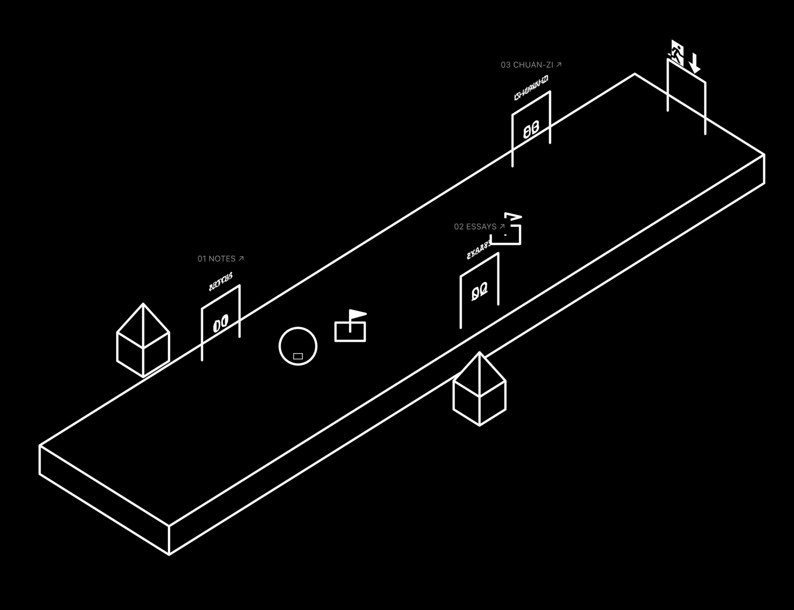

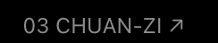

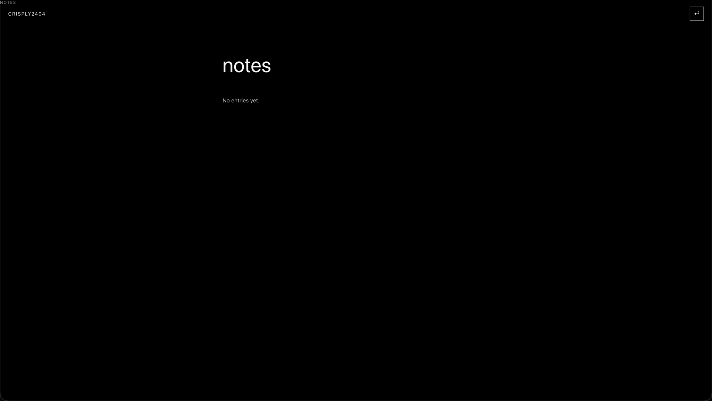

附件保留会话提供的 PNG 数据，尺寸依次为 1790 × 1376、244 × 48、2048 × 1155。

用户提供的 skill 内容：[ask-matt SKILL.md](docs/chat-assets/ask-matt-SKILL.md)。

### 助手公开消息

我会使用 `ask-matt` 选择这次修改需要的流程，并检查遮挡、门牌和寻路的当前实现。favicon 建议保留黑色背景与白色线条；阅读页建议把导航放在正文上方，目录页提供主页入口，文章页显示所属目录。

我会按 `ask-matt` 的流程继续处理，先重新读取当前项目规则和相关实现，再完成代码、文档、历史提交与验证。你提出的入口文字、遮挡、寻路、操作提示、favicon、阅读页导航和聊天记录格式都会一起纳入。

这次采用 `implement`，在现有物理、导航和 GPU 检查入口验证修改，完成后使用 `code-review` 检查项目规则与需求。Issue 标题可以继续使用清楚的问题描述；Conventional Commits 规范用于提交消息。

直走廊的导航检查已经通过：路径从当前位置直接连接点击目标。复杂地形会按可行连接的移动时间选择路线，并保留经过真实物理验证的跳跃连接。门牌将使用单份朝向镜头的文字，球体与门内部参与深度遮挡。

GPU 检查已经重现了球体遮挡后方线条的问题。我正在核查深度纹理的使用；门内部、球体、后方线条和地面涟漪都会通过直接读取 GPU 像素验证。

球体与门内部的 GPU 遮挡检查已经通过，涟漪也通过了方块表面范围检查。阅读导航采用正文上方的一行主页与目录链接，favicon 采用黑色背景和白色门框。记录规则会按 `writing-for-agents` 更新，并保存可读的问题与回答。

复杂地形的检查也已通过：导航选择了环绕缺口的最短安全路线，并通过真实物理执行到达目标。接下来完成浏览器复测与两项代码审查，同时将八条历史提交消息更正为 Conventional Commits；每个历史提交的文件内容都会逐项核验。

两项审查正在检查规则与需求。历史消息已经更正，逐项核验确认八个提交的文件内容保持一致。浏览器复测期间发生了开发服务热更新，我会固定当前文件状态后运行完整检查。

类型检查、九项物理与导航检查、构建和十五项 Godot 参考图比较已经通过，最大参考图误差为 1.65%。审查发现的不同高度点击起点问题已经修正，并补充了真实跳跃验证；完整浏览器操作检查仍在运行。

需求审查还指出了涟漪的线宽问题。我会让圆环宽度依据屏幕投影计算，并增加多个方向的 GPU 数值检查，使它沿用场景的线条规则。

浏览器检查已经通过桌面与移动端操作、137 项原物件 GPU 检查以及 7 项网站物件检查；涟漪在两个轴向的 DPR 1 线宽约为 2.52 和 2.51 像素，DPR 2 也保持一致。现在整理聊天记录中的残留传输字段，提交验证文档，再推送重写后的历史。

全部本地检查已经通过，代码与 Conventional Commits 历史已经推送。GitHub Pages 发布成功，线上三个入口、绘制资源和阅读导航检查通过；favicon 使用原游戏比例的门框与球体。

### 助手最终回复

[个人网站](https://crisply2404.github.io/)已经更新：

- 走廊保留透明出口图案，球体与门内部正确遮挡后方物件；检查点、接触标记、门内编号和悬浮链接已移除。
- 门牌统一显示单份文字并放大，项目名称显示为“击鼓传字”。
- 点击移动直接连接安全目标，复杂地形按可行连接耗时选择路线；涟漪限制在方块表面，各个方向保持相同显示宽度。
- 进入主页显示旋转视角和切换 W 指向等提示，随后淡出。
- favicon 使用黑色背景、白色空门框和原游戏比例的球体；阅读导航位于正文上方。
- 八条历史提交消息已更正为 Conventional Commits，历史文件内容保持一致。Issue 标题继续使用清楚描述。
- 聊天记录已整理为可读 Markdown，三张附件与 skill 内容已归档。

物理、浏览器、DPR 1/2/3、Godot 参考图、构建和线上检查通过；Standards 与 Spec 审查通过。

## 2026-10-11 02:39 Asia/Shanghai

### 用户消息

1.首先以后你commit别动不动一点小改动就commit，值得commit的时候再commit。然后啊，我觉得其实好像也不用面包屑，因为你用了面包屑之后好像都把原来的布局改了，我是想着让Crisply2404常驻左上角的，像刚进入网页形态那样，结果你给弄去分类的右上角了，然后那个分类的标题还写那么大。如图1。你甚至改回原来那样，然后只把最左上角的“NOTES"这种标题去掉都更好。

2.我希望门的内部是不透明的，除了对球以外，球是不会被门内部挡住的。

3.我们的favicon是正视图，而游戏是等轴测斜的，我希望favicon能还原我们游戏里球在门框内的场景

4.如图二，字太大了，而且跟门有重叠。

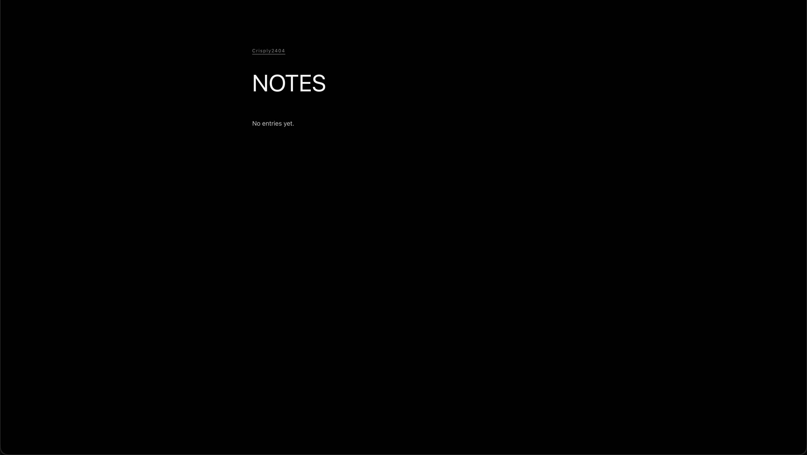

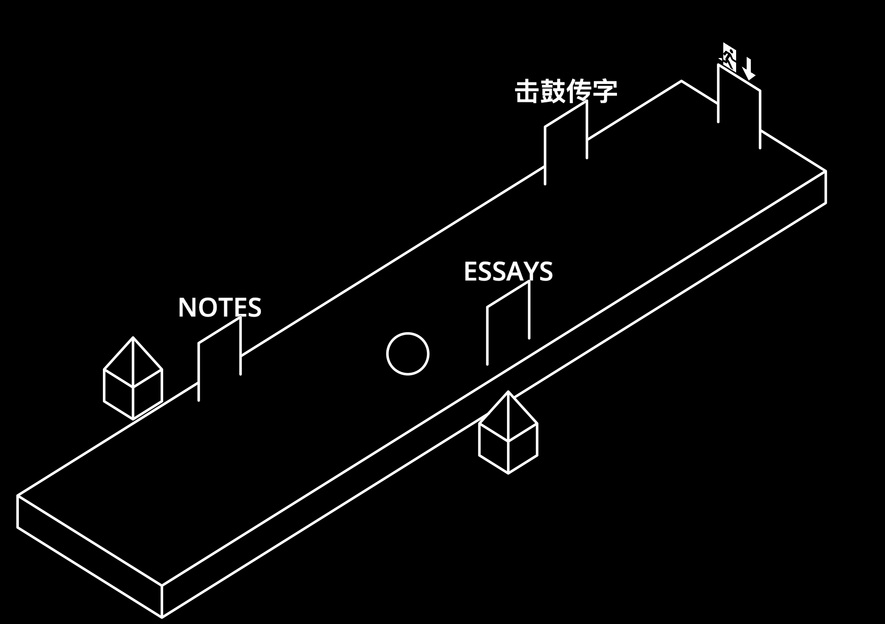

附件保留原始上传 PNG，尺寸依次为 3840 × 2166、2348 × 1656。

### 助手公开消息 · 02:39

我会把阅读页恢复为原来的页面结构：`Crisply2404` 固定左上角，去掉左上方分类标题，只保留正文中的分类标题，并调整门牌、门内遮挡和等轴测 favicon。所有修改完成并验证通过后只创建一个合并提交。

### 用户消息 · 02:40

用户提供的项目指令原文：[AGENTS.md instructions](docs/chat-assets/2026-10-11-project-instructions.md)。

### 用户消息 · 02:40

5.我希望你每个门里面都能放上象征那个门内的东西的symbol，比如击鼓传字你就放chuan-zi的favicon的那个符号

### 助手公开消息 · 02:40

新增的门内 symbol 也会纳入本次修改：我会从本地 `chuan-zi` 项目读取它现有的 favicon 图形，只复制到主站的门内显示资源，不修改 `chuan-zi` 源代码。每个门使用对应入口的 symbol，门牌文字保持较小并与门框分离。

### 助手公开消息 · 02:42

我会按本轮已经确定的设计继续修改：保留游戏场景与遮挡规则，恢复阅读页左上站点名称，给三扇门加入对应 symbol，调整门牌与 favicon，并把本轮消息和图片归档。完成后统一运行项目检查、浏览器检查与图形验证，再创建一个完整提交并发布。

### 用户消息 · 02:42

6.注意我们文字的线条的粗细也要和我们游戏中元素在摄像机（玩家）看来的线条粗细一致，不知道你能不能做到这一点

### 助手公开消息 · 02:42

我已把新增要求纳入同一轮：门内 symbol 会作为场景物件参与深度关系，symbol 的线条与门框、平台和球体使用同一套屏幕显示宽度计算；门牌文字也会按游戏的投影尺度校准，保证观察者看到的线条宽度一致。

### 用户消息 · 02:44

7.注意每个房间的房间名也要和门是同倾斜度的，跟门在同一个平面

### 助手公开消息 · 02:44

房间名称会固定在门所在的平面，随门一起呈现相同的倾斜角度。文字与 symbol 的绘制会使用游戏的线条算法，取消面向镜头的门牌旋转，并通过实际 GPU 像素检查线宽和门牌间距。

### 助手公开消息 · 02:46

门内部需要单独处理球体：它继续遮挡后方平台和图案，同时让可见球体穿过门内部显示；平台等物件仍然可以遮挡球体。门名将采用单线笔画，笔画与门框共用 2.5 世界单位线宽，门内分别显示笔记、书写和击鼓图形。

### 助手公开消息 · 02:51

球体透过门内部显示的 GPU 检查已经通过，门内部仍然遮挡后方线条。两张图片已按原始上传数据归档；阅读页恢复了左上站点名称。现在检查四个镜头方向中的门名倾斜、symbol 遮挡和文字线宽。

### 助手公开消息 · 02:59

本轮继续使用 [implement](/Users/hco/.agents/skills/implement/SKILL.md) 完成修改，并使用 [code-review](/Users/hco/.agents/skills/code-review/SKILL.md) 分别检查项目规则与需求。[writing-for-agents](/Users/hco/.agents/skills/writing-for-agents/SKILL.md) 用于记录提交频率规则。验证仍通过现有的真实物理、浏览器与 GPU 检查入口进行。

### 助手公开消息 · 03:01

门名和 symbol 的实际笔画测量已完成：DPR 1 下宽度约为 2.49～2.50 像素，与游戏的 2.5 像素线条一致。十五项 Godot 参考图比较和九项物理检查通过。完整浏览器检查还在复测，随后进行规则与需求审查。

### 助手公开消息 · 03:05

规则与需求审查均未发现明确遗漏。浏览器操作复测会继续核查点击产生涟漪、到达门前和自动进入页面，并补齐 DPR 2/3 的图形验证记录。所有相关修改仍会统一提交。

### 助手公开消息 · 03:08

桌面键盘、鼠标寻路、自动进入门和手机双指操作已经通过，DPR 2 的原物件与网站物件检查也通过。门牌现在随门保持同一平面，文字下缘与门框之间留有固定间距；DPR 3 检查完成后即可发布。

### 助手公开消息 · 03:10

全部本地检查已通过，包括 DPR 1/2/3、四个镜头方向、球体与门内图案的遮挡、十五项 Godot 参考图比较和构建。现在把代码、设计记录、聊天原文与两张附件统一提交，随后验证 GitHub Pages 上的入口、阅读页和 favicon。

### 助手最终回复

门名已与门保持同一平面，文字与 symbol 共用游戏线宽。三扇门分别显示笔记本、书写和原 favicon 的击鼓图形；球体可以透过门内部显示，仍受其他物件遮挡。

阅读页保留左上方 `Crisply2404`，分类标题恢复合适尺寸；favicon 使用游戏镜头下的空门框与球体。

物理、浏览器、DPR 1/2/3、Godot 参考图和构建检查通过。本轮修改统一为一个 Conventional Commit，聊天原文与图片已归档。

[查看网站](https://crisply2404.github.io/)

## 2026-10-11 03:31 Asia/Shanghai

### 用户消息

1.这个字在反面的时候看起来是左右翻转的，如图1，我希望不要这样。
2.如图2，我感觉这字有点别扭，NOTES的O好像离N和T的间距比较远，然后essays的每个字母间距又正常。能不能保证每个字母间距一样，还有这个是你手画出来的吗？能不能不要自己建模手画？还有我觉得击鼓传字那个门其实有图标就行了，不用在上面标房间名“击鼓传字“了。

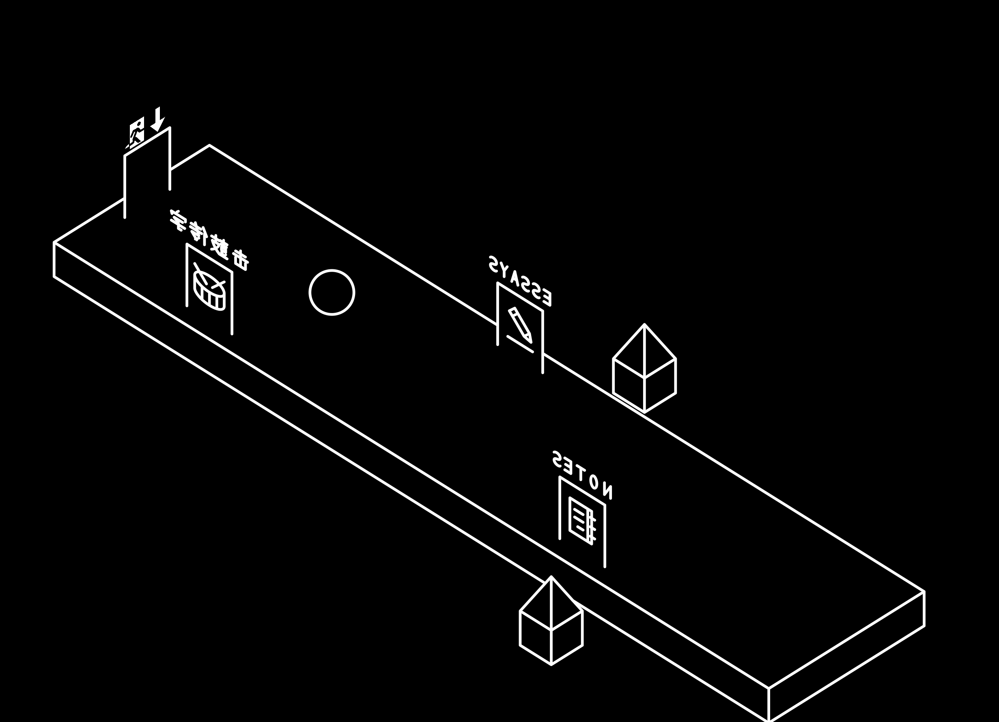

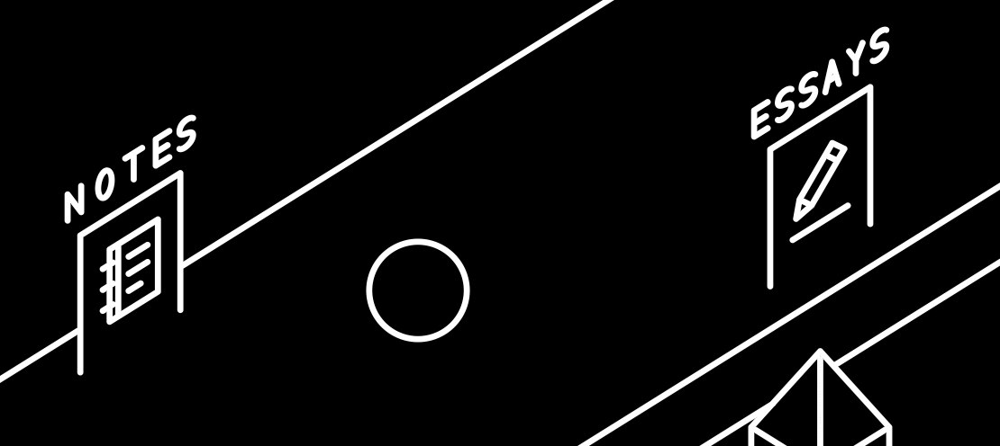

### 助手公开消息

门名目前确实是我手绘的 SVG 笔画。我会改用现成字体统一排版，保持与门相同的倾斜和游戏线宽，让正反两面都能正常阅读；“击鼓传字”门上方的名称会移除，保留门内图标。

### 用户消息 · 03:34

3.我发现你点进去notes里的的<a class="site-title" href="/">Crisply2404</a>的位置会比起上一页往上一点，和上一页的位置不一样，请修复。

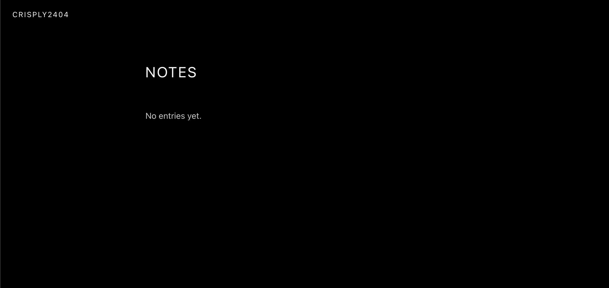

### 助手公开消息

我会把站点名称的位置修复一起纳入这次修改，并检查主页、notes 和 essays 的实际坐标是否一致。

### 助手公开消息

这次继续使用 [implement](/Users/hco/.agents/skills/implement/SKILL.md) 完成修改，并用 [code-review](/Users/hco/.agents/skills/code-review/SKILL.md) 检查规则与需求。相关修改、文档和验证记录会统一提交。

### 用户消息 · 03:36

4.其实每个门里的图标的线条粗细没必要和整个游戏一样，只要自然而且图标之间的线条粗细是一样的就行。我感觉击鼓传花的图标的线条粗了会难看。还有，你门名其实也是，每个门名之间看着是一致的就行，你甚至能用回字体而不是手绘svg，只要自然而且别被挡住就行。

### 助手公开消息

新增要求已纳入：门名使用游戏现有的 Open Sans 字体，统一字母间距和显示尺寸；门内图标采用彼此一致的自然线宽。门名仍与门保持相同倾斜，背面正常阅读，“击鼓传字”门只显示图标。

### 助手公开消息

测量确认，站点名称进入 notes 后原本向上移动了 11 像素。修复后两页的位置已经一致。门名已改用现有字体；正在验证正反阅读方向、字母间距和三种图标的显示线宽。

### 用户消息 · 03:43

5.操作提示应该换成英文，还有“tab切换w指向“应该改为“tab切换控制模式“

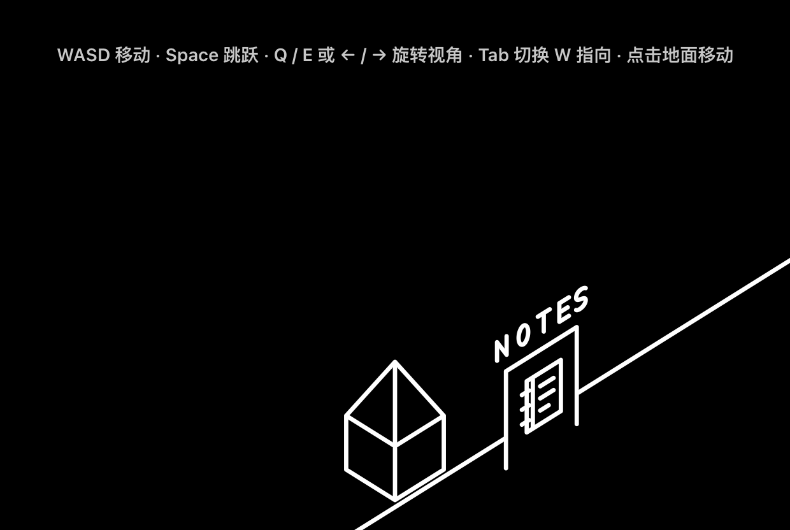

### 助手公开消息

操作提示会改为英文，Tab 的说明使用 “Switch control mode”，并保留现有淡出效果。字体与图标的 GPU 检查已通过，完整浏览器操作检查仍在进行。

### 助手公开消息

门名正面与背面的文字像素比较结果一致，三种图标的线宽约为 1.50 像素。十五项 Godot 参考图比较、九项物理检查和构建已通过；正在检查手机操作及页面坐标。

### 助手公开消息

桌面与手机的列表页、notes、essays 已通过站点名称坐标检查，英文提示也已加入。规则与需求审查未发现功能遗漏；浏览器寻路检查出现间歇性失败，正在确认原因。

### 助手公开消息

全部本地检查已经通过，包括 DPR 1/2/3、正反文字阅读、桌面与手机操作、页面坐标和 Godot 参考图。聊天原文与四张原图已归档，现在统一提交并发布，随后核查线上页面。

### 助手最终回复

- 门名使用现有字体，统一字母间距，正反面正常阅读。
- “击鼓传字”门仅显示图标，三个图标使用一致的自然线宽。
- `Crisply2404` 在列表页、notes、essays 中位置一致。
- 操作提示改为英文，Tab 显示 “Switch control mode”。

浏览器、物理、构建和 Godot 参考图检查通过；本轮统一提交，聊天原文与四张原图已归档。

### 用户消息 · 04:11

我觉得操作提示按照我们的美学，应该不用文字说明，而是用图示+游戏内元素的动画来说明。直接用鼠标图标或者特殊符号来代表鼠标，wasd也是用wasd示意键图。tab就直接用那个十字五格和箭头的那个提示循环播放

### 助手公开消息

操作提示会使用按键图示、鼠标符号和游戏物件动画；Tab 使用现有的五格方块与箭头预览循环展示三种控制模式。

### 助手公开消息

现有五格预览可以直接用于 Tab 动画。提示会分别展示球体移动、跳跃、90 度视角旋转和点击后出现涟漪并移动，按键图示同步高亮；整组提示循环播放后淡出。

### 用户消息 · 04:16

还有我怎么老是感觉每个字母之间的空隙不一样，能不能弄好点，还有我想要那种latex默认编译出来的那种字体，我不知道叫什么反正我觉得比较优雅，而且门名只有首字母大写，其他字母不要大写。

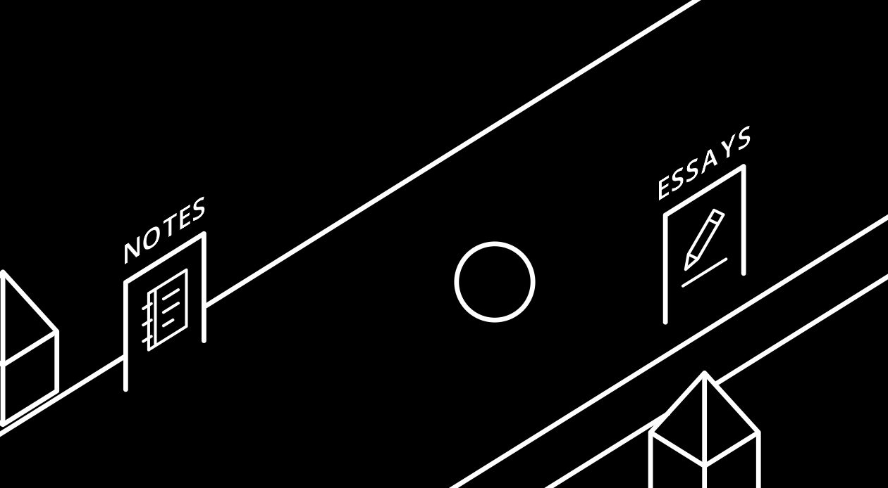

### 助手公开消息

LaTeX 常见的默认字体叫 Computer Modern。我会使用同系列的 Latin Modern Roman，把门名改为 `Notes` 和 `Essays`，让字体系统处理完整单词的字距，并保持门名的倾斜和正反阅读方向。

### 助手公开消息

门名将使用 Latin Modern Roman 的完整单词排版，显示为 `Notes` 和 `Essays`。图示操作提示也在继续验证，包含按键高亮、球体动画和 Tab 控制模式循环。

### 助手公开消息

门名会交给字体自身的 kerning 处理字距，两扇文字门使用相同字号。名称仍与门处于同一平面，背面也保持正常阅读方向。

### 助手公开消息

本地 GPU 检查发现新字体纹理在门名测量场景中没有形成可见像素。我正在检查 Canvas 纹理的绘制坐标与门平面位置，修复后再继续完整检查。

### 助手公开消息

门名已通过正反面 GPU 检查，两面的文字图像一致。Latin Modern Roman 已加载，名称显示为 `Notes`、`Essays`；操作动画正在检查完整循环和手机画布边界。

### 助手公开消息

五组动画在桌面、手机竖屏和横屏都通过了画布边界检查，Tab 能循环展示三种控制模式，提示按时淡出。十五项 Godot 参考图比较、九项物理检查和构建也已通过。

### 助手公开消息

动画与字体检查已通过。完整浏览器操作检查中出现了一次寻路停滞，我正在读取真实位置与速度记录，并检查提示动画运行时的寻路结果。

### 助手公开消息

寻路停滞的原因已确认：球体接近平台表面时，碰撞检测反复返回零距离接触。现在会恢复正确的接触距离，新增的真实物理检查已通过，原有移动速度和跳跃检查也通过。

### 助手公开消息

接触修复已连续通过六次浏览器寻路验证。接下来使用 Matt 的 `code-review` skill，分别检查项目规则和用户需求；本轮修改会统一为一个提交。

### 助手公开消息

全部本地检查通过，规则审查和需求审查均未发现问题。本轮修改已统一提交，GitHub Pages 正在发布，随后检查线上字体与图示动画。

### 助手最终回复

门名已使用 Latin Modern Roman（Computer Modern 同系列），显示为 `Notes`、`Essays`，采用字体自身的自然字距。

操作提示使用图示与游戏动画，Tab 循环展示三种控制模式，随后淡出。

浏览器、物理、Godot 参考图、构建和线上检查通过。本轮统一提交并发布，聊天原文与图片已归档。

### 用户消息 · 06:05

1.如图一，我认为操作提示的背景应该是透明的，而不是弄个黑色底板，但同时我希望操作提示本身是不透明的（类似门内部那样），而且在最前的图层

2.我认为操作提示的按键图示应该修改，tab不用那个制表符，就Tab就行，而且每个按键的边框应该改成类似手机版操作按键那样，就是不带任何圆角的正方形按键，且边框线条粗一些（如图4），tab的话就是h跟其他键一样但w就长（我说的是按键尺寸）。然后W默认是朝上的，也就是第二个操控模式，所以wasd操作的图示动画也要修改。鼠标操作可以直接和wasd并列。

3.我认为手机操作的示意图可以专门做，把手机的方向键去掉，只保留旋转和跳，并把按钮放到合理的位置（不要占屏幕），手机的移动方式只保留类似电脑鼠标那样的单指点击移动方式；然后手机可以双指放大和移动视野，但这不会影响到按键。注意手机的示意图专门做，包括单指和双指的动画

4.手机上面看到的网页模式的排版很丑，如图2，而且和电脑版的网页模式（如图3）看着不一致。还有Crisply2404是只有首字母大写的，而网页模式你是全大写，请改成首字母大写。

5.我认为门名不要使用latex字体，线条太细了而且不符合画风，你觉得要不要用我们按键图示那个字体，也就是本来就有的那个字体，然后请你保持自然间距，别自己人为加和改动间距。

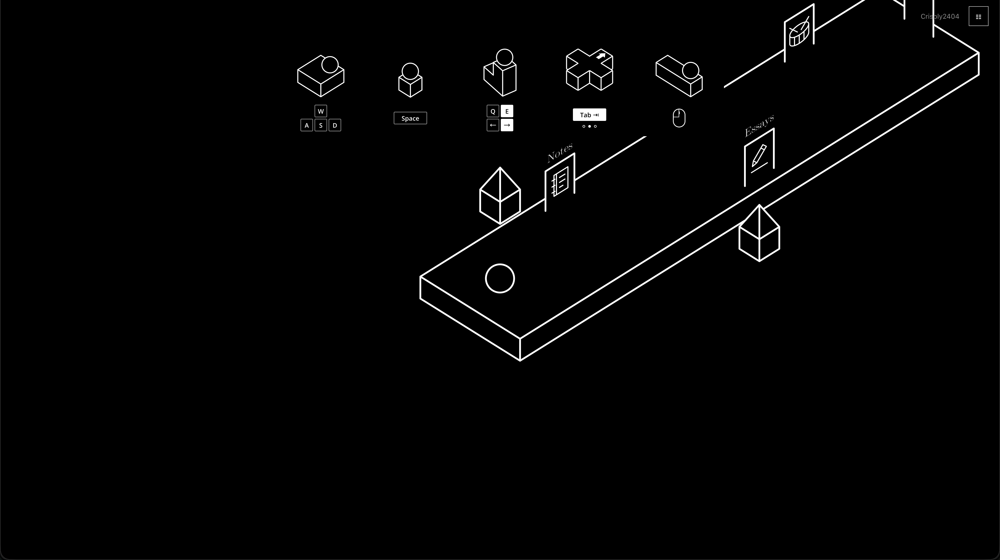

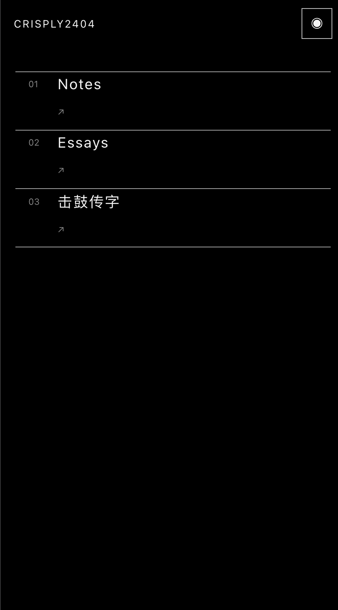

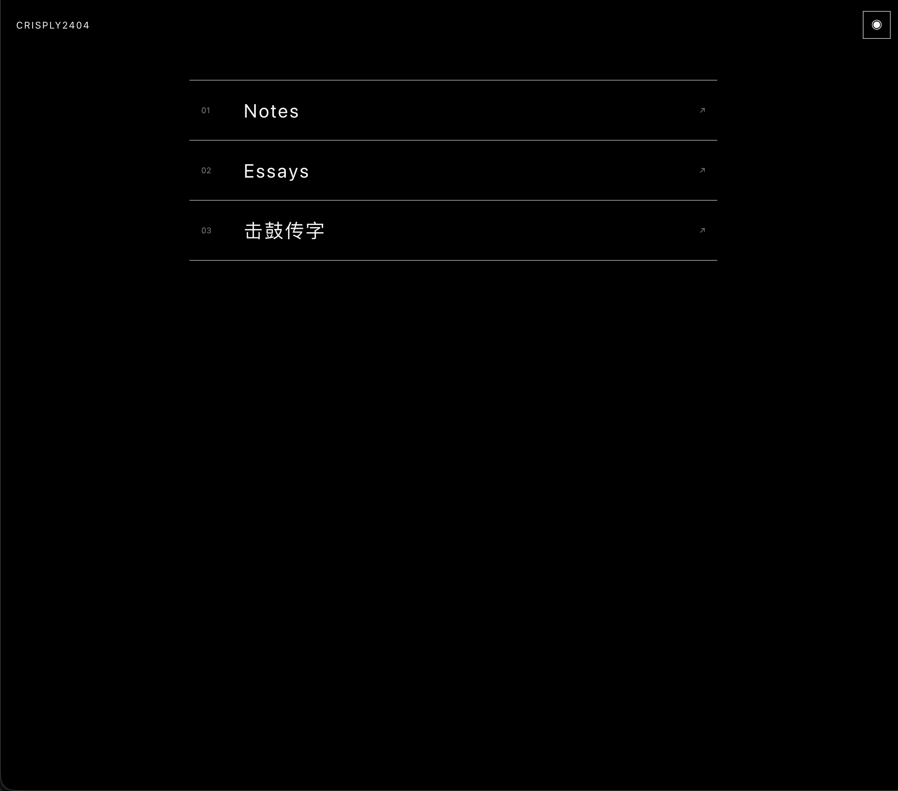

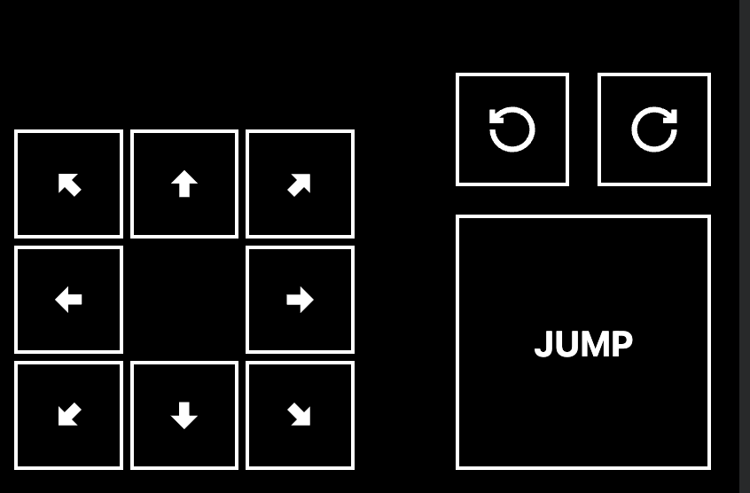

### 助手公开消息

这轮会把操作提示、手机专用示意、列表页排版和门名字体一起调整，并保留真实游戏场景的前后遮挡。门名改回现有 `Mono Tower` 字体，使用字体自带的完整单词排版与 kerning，不手动添加字间距。

### 助手公开消息

我会继续按已确认的设计实现这轮调整：透明且置前的提示层、桌面与手机专用操作示意、手机列表排版、站点名称大小写，以及门名字体。完成后会运行完整检查并更新任务记录。

### 助手公开消息

提示画布目前会把整个区域输出为黑色，因此透明效果需要同时调整画布和最终绘制。手机列表的箭头换行来自两列布局，我会保持三个元素在同一行。门名使用现有 `Mono Tower` 字体和字体自带间距；这轮沿用 Matt 的 `implement` 流程，并在提交前使用 `code-review` 审查。

### 助手公开消息

手机触摸现在分别由画布和按钮处理：画布接收单指点击、双指缩放与平移，旋转和跳跃按钮保持独立。双指手势结束后不会触发寻路。接下来验证专用提示动画、透明像素和实际多点触控。

### 助手公开消息

类型检查、十项物理检查和生产构建已经通过。门名字体与正反阅读检查也通过了 GPU 验证；浏览器操作检查需要配合新的默认控制方向更新。桌面与手机动画正在检查完整循环、画布边界及透明区域。

### 助手公开消息

桌面键盘、鼠标寻路、自动进门，以及手机单指寻路、双指缩放和平移、按钮独立操作都已通过检查。十五项 Godot 参考图比较也通过了。手机提示在宽屏尺寸下有物件超出画布，我正在调整提示投影的可见范围。

### 助手公开消息

桌面五组提示和手机四组提示已通过四种屏幕尺寸的完整动画检查。GPU 检查确认空白区域透明、物件内部不透明，动画没有超出画布。四张原图也已保存到聊天附件目录，接下来完成整套浏览器验证和代码审查。

### 助手公开消息

完整浏览器检查、十项物理检查、十五项 Godot 参考图比较和构建已经通过，规则审查与需求审查均未发现问题。本轮修改会统一提交并发布，随后检查线上提示、字体和手机列表。

### 助手公开消息

本轮修改已统一提交，GitHub Pages 正在发布。线上检查会确认桌面与手机提示、站点名称、列表布局和字体资源。

### 助手最终回复

- 提示背景透明，物件与按键内部不透明，并显示在最前图层。
- 桌面按键采用直角边框，Tab 仅显示文字，W 默认朝上。
- 手机使用专用动画，支持单指寻路、双指缩放和平移，仅保留旋转与跳跃按钮。
- 手机列表保持同行排列，站点名称为 `Crisply2404`。
- 门名使用现有 Open Sans Semibold 字体，保持自然字距。

检查通过，已统一提交并发布；聊天原文与四张原图已归档。

### 用户消息 · 06:33

1.如图1，手机端按按键会让按键浮现这个蓝色，我不知道这是不是浏览器默认就是这样，按button就会浮现蓝色，总之我不想浮现蓝色。
2.如图2，我觉得按键的边框还是太粗了，还是细一点好，我要自然的。如图5，手机版的操作提示的按键图的边框也是太粗，一起改细。
3.我觉得门名的字体可以用我们网页模式的标题字体，如图3，包括操作提示的按键里面的字体也可以用我们网页模式的标题的字体。
4.如图4，我觉得这些内部有图标的门的内部应该对球不透明，即门可以遮蔽球。

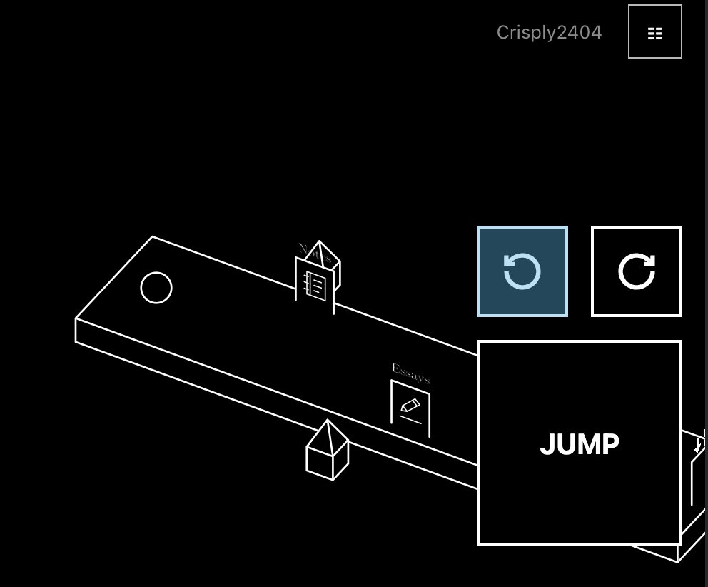

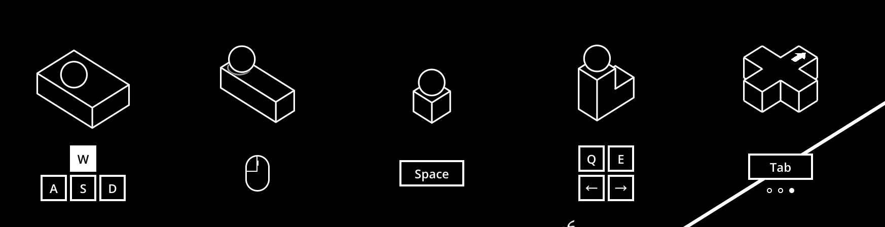

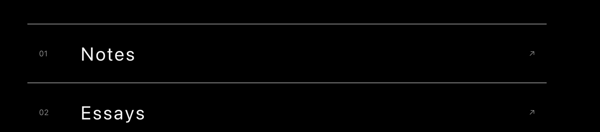

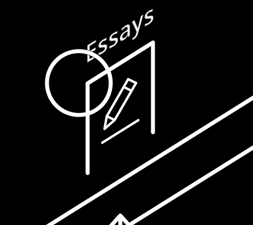

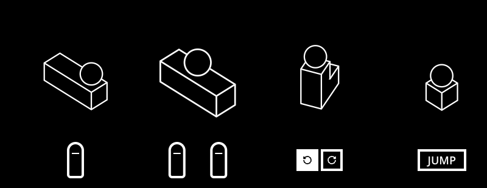

### 助手公开消息

我会取消触屏按钮的蓝色点击反馈，调整按钮与提示按键的边框，并让门名、按键文字使用网页入口标题的字体。带图标的门内部也会参与球体遮挡。

### 助手公开消息

网页入口标题使用系统无衬线字体，字重为 400；门名和按键文字会共用这项设置，并保持自然字距。带图标的门将使用完整的不透明表面，球体与门内图案按照前后位置互相遮挡。

### 助手公开消息

按钮和提示按键已改为 1 像素边框，并共用网页标题字体。类型、物理、构建和十五项 Godot 参考图检查已经通过。门后球体与部分遮挡检查也通过了，正在核对门前球体、触摸反馈和完整浏览器操作。

### 助手公开消息

三扇图标门的正反面、完全遮挡、部分遮挡和门前球体显示已通过 GPU 检查，门名正反面的文字图像一致。完整浏览器检查仍在运行；随后使用 Matt 的 `code-review` 分别审查项目规则和本轮需求，修改仍统一提交。

### 助手公开消息 · 06:41

我会继续处理当前四项修改，并完成手机浏览器检查、需求审查、发布验证与聊天记录归档。现在先重新读取项目规则和当前失败检查的位置。

### 助手公开消息 · 06:44

独立手机页面已正常启动并进入地面状态，暂时没有重现上次的等待超时。完整浏览器检查正在重新运行，会继续检查真实触摸反馈、字体、门与球体遮挡，以及不同屏幕像素密度下的渲染。

### 助手公开消息 · 06:45

完整浏览器检查已完成手机触摸、双指手势和四种屏幕尺寸的提示动画检查，DPR 1、2、3 的门与球体遮挡检查全部通过。规则审查和需求审查均未发现问题，本轮修改将统一提交并发布。

### 助手公开消息 · 06:47

统一提交 `2d735ba` 已推送到 `main`，部署工作流已启动。接下来等待 Pages 完成，再运行线上桌面与手机验证。

### 助手公开消息 · 06:47

GitHub Pages 构建与部署已成功完成，私有 `chuan-zi` 构建产物也已发布到 `/chuan-zi/`。现在运行线上页面检查，确认部署内容与本地结果一致。

### 助手最终回复

- 手机按钮取消蓝色触摸反馈，保留黑白反馈。
- 操作按钮与提示按键边框统一为 1 像素。
- 门名和按键文字使用网页标题字体，保持自然字距。
- 图标门按前后位置遮挡球体。

检查通过，已统一提交并发布；聊天原文与五张图片已归档。
